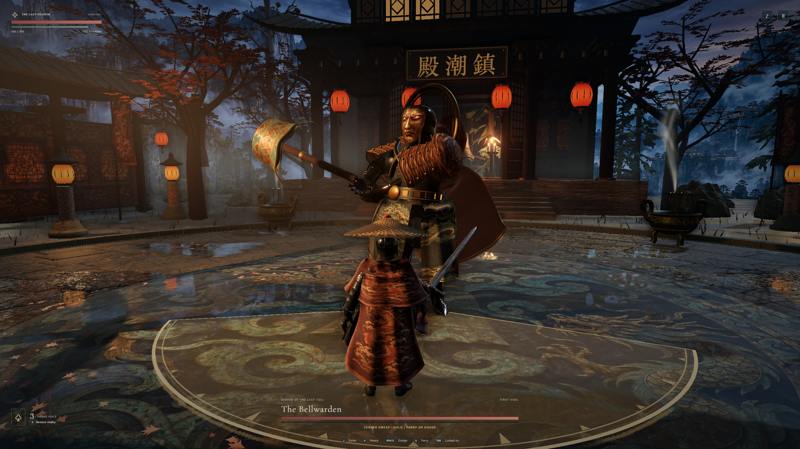
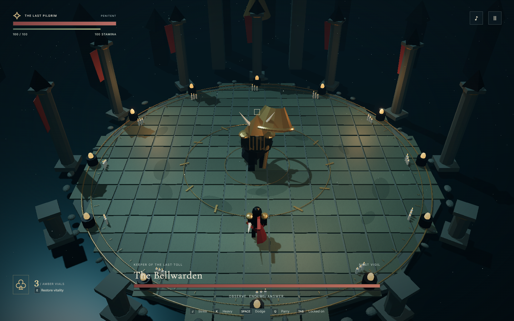
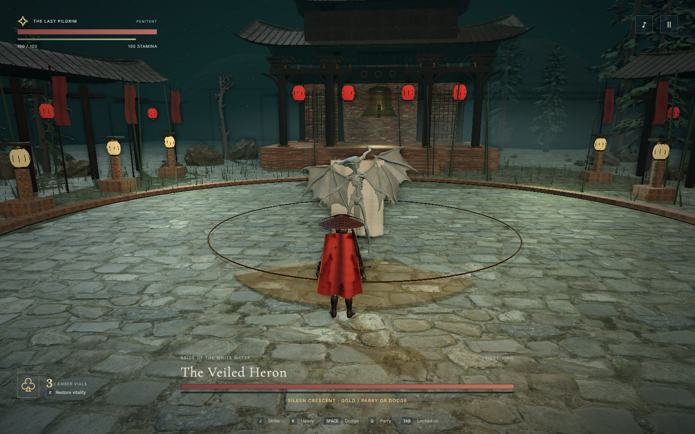
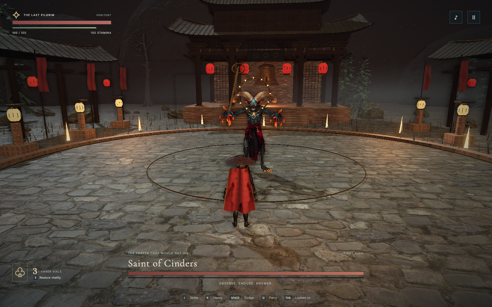

# Vesper — The Hollow Tide

**Visual rebuild in progress.** The browser prototype below did not meet the requested Bloodborne / Wuchang visual standard. A [native Unreal rebuild](native/README.md) is being prepared; it has no playable native level yet.

**Three fallen saints. One last bell.**

An original, playable 3D soulslike boss-rush chapter for the browser. Deliberate melee combat, weathered temple courtyards, detailed armoured and skeletal characters, pale feathers, and an adaptive dark-ambient score. Inspired by the tension and combat language of games such as Bloodborne and Wuchang: Fallen Feathers; no characters, music, models, or other assets from those games are used.



[Watch a complete Bellwarden victory with sound](docs/runtime/vigil/bellwarden.mp4) · [Three courts in gameplay](docs/runtime/vigil/) · [Rain courts in motion](docs/runtime/rain/) · [Three encounter galleries](docs/runtime/sanctuary/) · [Bellwarden combat with game audio](docs/runtime/bronze/bellwarden.mp4)

## Play locally

Requires Node.js 22.12+ and a current browser with WebGL 2. Runs on Apple Silicon / ARM64; there is no native binary or server backend.

```sh
npm ci
npm run dev
```

Open the printed local URL. Headphones recommended. Select any of the three encounters; all are available for practice from the start. Defeats, best clear times, and settings save in this browser. Clearing all three completes the chapter.

```sh
npm test        # deterministic combat, progression, and save validation
npm run build  # strict TypeScript check + production bundle
npm run preview
```

The `dist/` folder is portable static output: host it over HTTP on any static host. Fonts, art, game code, and audio synthesis are self-contained. The first encounter downloads roughly 35 MB of models and textures; later encounters reuse that cache. The relative asset base supports hosting below a subpath. Do not open `index.html` with `file://`, because ES modules require an HTTP origin.

## The three vigils

| Boss | Arena | Fight identity | Second phase |
| --- | --- | --- | --- |
| The Bellwarden | The Drowned Belfry | Weighty censer sweeps, radial bell slams, committed charges | Faster tells and chained attacks |
| The Veiled Heron | The Garden of Veils | Fast curved blades, feather fans, lunges | Wider projectile fans and chained patterns |
| Saint of Cinders | The Ashen Reliquary | Staff sweeps, expanding fire rings, delayed floor eruptions | Double rings, more eruptions, chained prayers |

Gold tells can be parried. Red tells must be dodged or avoided. Attacks lock their aim before impact. Staying aggressive restores the pale, recoverable portion of recently lost health. Strikes and parries break posture; a heavy strike against a kneeling boss deals a riposte.

**Penitent** is the intended challenge. **Pilgrim** reduces incoming damage, widens the parry window, speeds stamina recovery, and grants five healing vials. Difficulty changes apply on the next attempt.

## Controls

| Action | Keyboard / mouse | Standard gamepad |
| --- | --- | --- |
| Move | WASD / arrow keys | Left stick |
| Light strike | J / left mouse | X / Square or RB / R1 |
| Heavy strike / riposte | K / right mouse | Y / Triangle or RT / R2 |
| Dodge | Space | B / Circle |
| Parry | Q | LB / L1 |
| Heal | E | A / Cross |
| Target lock | Tab | Right stick click |
| Pause | Escape | Start / Options |
| Mute | M or music button | On-screen control |

The third-person camera follows the locked boss; movement is camera-relative. Target lock is on by default. With lock off, the mouse aims on the arena floor. Menus support keyboard navigation and gamepad D-pad/stick + A/B. Touch devices get a virtual movement stick and action buttons. A keyboard or controller is recommended for precise timing. Losing window focus automatically pauses combat.

## In-game captures





## Implementation

- `src/combat.ts`: rendering-independent, deterministic simulation at 120 Hz, authored boss state machines, collision and hazard rules.
- `src/scene.ts`: Third-person camera, rigged GLB characters, ornate temple geometry, animated cloth, instanced vegetation, weather, PBR stone/metal/wood, HDR lighting, SSAO, bloom and shadows.
- `src/assets.ts`: local CC0 model and texture loading, skeletal cloning, material ownership and model normalization.
- `src/audio.ts`: original Web Audio synthesis: inharmonic bells, layered drones, melodic motifs, percussion, stereo placement, impulse reverb and master compression. No audio downloads or AI calls at runtime.
- `src/main.ts`: input, menus, fixed-step loop, HUD, audio lifecycle, encounter progression.
- `src/save.ts`: versioned and validated local storage, safe fallback when storage is unavailable.
- `tests/combat.test.ts`: combat timing and deterministic agent clears using normal player actions on both difficulties.

This is a focused first playable chapter, with a realism-oriented material pass, imported prototype characters and synthesized audio. It does not match the asset fidelity, bespoke animation or production scale of Wuchang; the next art milestone requires purpose-built Chinese fantasy characters and authored combat animation. It is not a full RPG: there is no exploration campaign, equipment system, multiplayer, or native executable. Controller mappings are implemented against the standard browser Gamepad API; physical controller and mobile-device testing remain separate from the Mac browser validation.

## Verification and assets

See [verification notes](docs/VERIFICATION.md), [encounter design](docs/DESIGN.md), and [asset provenance](docs/ASSETS.md). CI runs tests and production builds on Linux and Apple Silicon macOS.

Code is MIT licensed. Imported models and scanned textures are CC0 with provenance in `docs/imported-assets.json`. Bundled fonts retain their SIL Open Font Licenses in `public/fonts/`.
