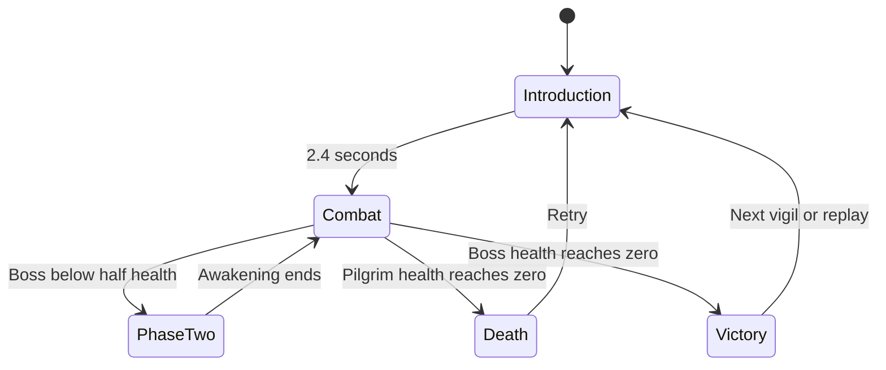

# Encounter design

The first chapter has one protagonist and three separate replayable encounters. The masked pilgrim carries a single ceremonial blade and a finite supply of amber vials. The title artwork describes a larger world; the shipped game concentrates on the boss arenas.

The visual language joins a ruined tidal monastery, bell towers, lacquer-red cloth, bronze inlay, ivory masks, and drifting ash. The revised scene uses scanned PBR surfaces, rigged textured characters, a close shoulder camera, layered eaves, carved timber brackets, brocade cloth and lantern light against cold mist. Imported character meshes are prototype assets; historical Chinese costumes and fully authored animation remain a later production milestone. Gold versus red telegraphs communicate whether parrying is possible; the same distinction is also written in the HUD, so color is not the only cue.

The Bellwarden teaches commitment: his wide sweep can be parried, the bell slam cannot, and the straight charge leaves a long punish window. The Veiled Heron changes the spacing problem with a fan of feathers and a quick approach. The Saint adds expanding rings and delayed ground targets, requiring movement while reading the next prayer.

Every second phase shortens tells to 82% and recovery to 85%, and adds one chained attack. Heron fans increase from seven to eleven feathers; the Saint creates two rings and eight eruption sites instead of one ring and five sites. Boss patterns are deterministic and can be learned. Target direction locks partway through the windup, so successful evasion is not defeated by an instantaneous turn.

Player attacks cost 17 / 32 stamina; dodging costs 23 and parrying 12. Light attacks hit after 140 ms, heavy attacks after 460 ms. Dodge invulnerability begins after 35 ms and ends after 340 ms. The parry window runs from 25 to 230 ms on Penitent (320 ms on Pilgrim). A successful parry restores 24 stamina and adds 55 enemy posture. A heavy riposte deals 130 damage.

Seventy percent of incoming damage becomes recoverable health for four seconds. A successful strike restores up to 55% of its damage from that pool. Healing takes 760 ms before restoring health; damage can interrupt it after consuming a vial. These rules create a choice between retreating, maintaining pressure, and saving stamina.

The score shifts its root between arenas and accelerates from a 480 ms pulse to a 360 ms pulse in phase two. It layers inharmonic bells, detuned drones, quiet minor-mode motifs and frame-drum textures. Sound starts only after the player enters an encounter; pause suspends the audio context.

The next production milestone would be bespoke animated characters, richer weapon-specific animation, authored recorded music, environmental traversal, and physical device playtesting. The current architecture keeps simulation independent so those changes can preserve combat rules.
