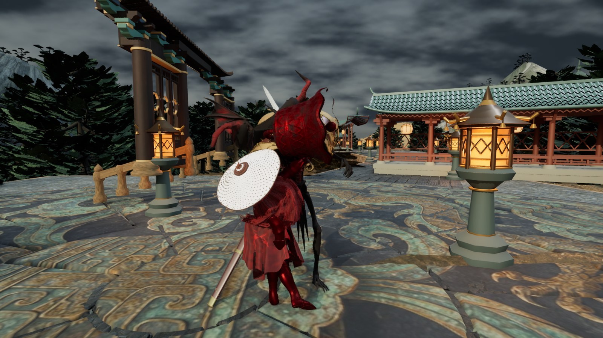
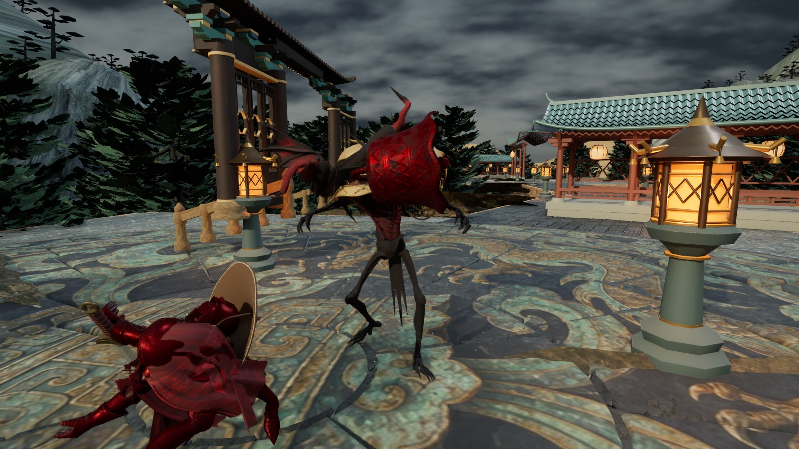

# Bellwarden in the mountain court

Unreal Engine 5.8.4 standalone editor game on Windows, RTX 5080, 1600 × 900. Both images are frames from the running level. The driver moved the real possessed character near the first court to start each trial.

The [sampled encounters](samples.json) use elapsed wall time. In the unanswered opening, two sweeps and one heavy toll reduced the pilgrim from 10 HP to 3 HP. In a separate trial the driver pressed and released the enhanced-input left mouse binding, moved towards the boss, and called the player's evasive step during windups. The Bellwarden reached zero HP after 20.16 seconds with the pilgrim still at 10 HP. This trial exercises the evasive move directly. A physical gamepad was not tested.

The first court has two faster swings and a slower, deeper bell signal before the third strike. Facing and reach are checked when the swing lands. Space steps in the movement direction, or backwards from rest. The step provides 0.22 seconds of invulnerability and can be used again after 0.75 seconds. Run it through the [native launcher](../../../native/README.md). Combat staging for the other two native courtyards is still in development.
