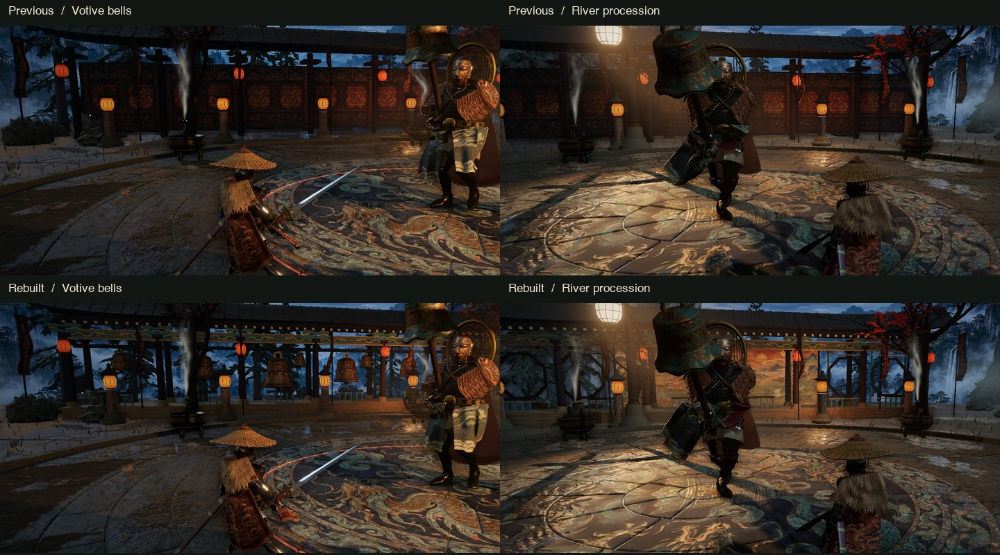

# Bellwarden court galleries

Captured in the production browser game at 1920 × 1080 on Apple M1 Max. The top row uses `4f18fed`, the lower row uses `3d83aca`. Both runs advance at fixed simulation steps with the same approach, strike and lateral inputs. The comparison crops the paired views identically. [Full bell walk frame](bells.jpg) · [Full river gallery frame](procession.jpg)

The open walk suspends eight cast bronze bells from timber beams. The opposite gallery frames a continuous river-procession painting with octagonal end windows. The rails break at three stairs on each side. The playable court uses raised stone decks, a rear row of columns, open bays and rafter tails to reveal different parts of the galleries as the camera moves.

The original mural was created with built-in ImageGen. The production texture is [River procession](../../../public/art/river-procession.jpg). Generation prompt:

> Create an original late-Ming Chinese temple wall painting as a flat artwork texture for an actual 3D game. Widest landscape aspect ratio available. Full bleed museum-quality straight-on orthographic conservation photograph of a single continuous mural on aged lime plaster, evenly lit, no external setting, perspective, fixtures, borders or text. A quiet river procession at dusk: in the middle horizontal band, a sinuous ancient sampan carrying three tall robed ritual musicians ringing small bronze bells, long flowing vermilion sleeves, distant azure limestone peaks and pines, a second small boat, bronze-gold water ripples and two long white egrets. Strong sweeping cloud shapes, sophisticated mineral pigments, meticulous Ming gongbi linework, surviving cinnabar and malachite, broken gold leaf, natural craquelure but preserve legibility from court distance. Arrange the scene in a sweeping long band across the middle half of the canvas so it can be trimmed. Keep it luminous and warm with cool jade water, areas of bare pale plaster, no inscription. Handmade historical wall painting, exquisite large shapes and economical tiny details.

A continuous 29.5-second recording on Pilgrim difficulty follows the normal camera and stereo game audio from the first approach through victory. Automated keyboard input circles the boss, reaches the awakened phase and lands three parries. A separate run cleared all three encounters. [Full duel](duel.mp4) · [Duel result](duel.json) · [Three clears and frame intervals](clears.json) · [CI for the playable revision](https://github.com/lzongren/vesper-hollow-tide/actions/runs/43604771095)
