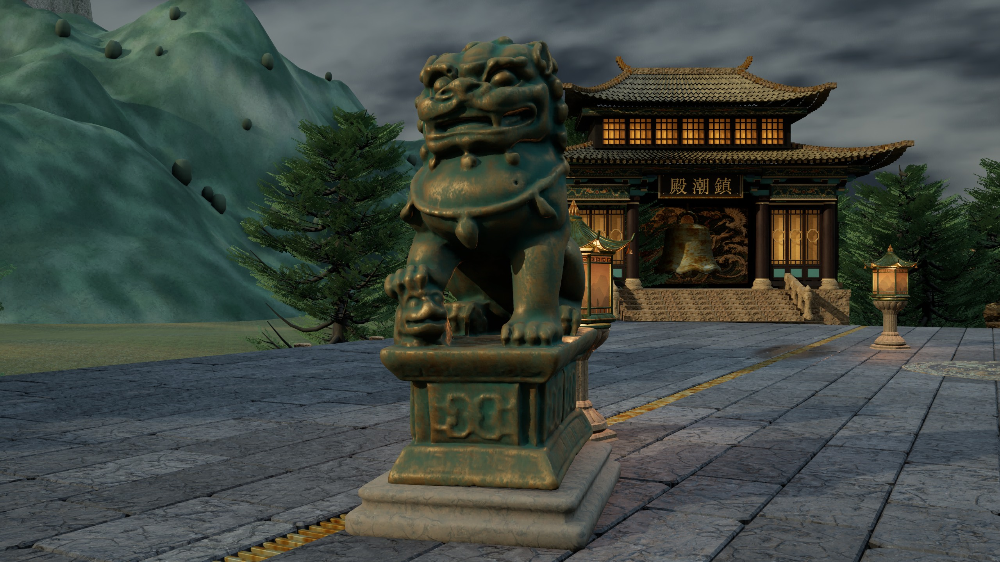
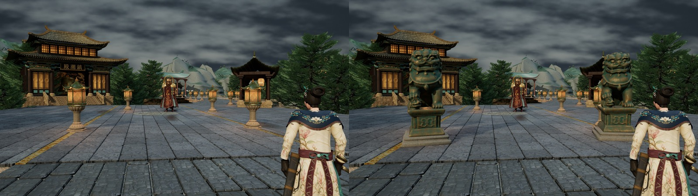

# Bronze guardians at the bell court

Two monumental castings stand on the edges of the procession road as it enters the first fight. The chased pedestal, curled mane and cub under the paw come from rvscanners’ digitization of a porcelain guardian lion. The game places the 2.82-metre sculpture on two shallow limestone courses. Raised details reveal rubbed bronze while copper oxides dull the recessed areas. [Source mesh, changes and attribution](../../../native/Art/BellCourt/README.md)

| View | Previous | Revised |
| --- | --- | --- |
| Approach | [Open road](before-entry.jpg) | [Guarded entrance](after-entry.jpg) |
| Paw and decorated pedestal | [Original view](before-carving.jpg) | [Casting detail](after-carving.jpg) |
| Return from the court | [Open road](before-court.jpg) | [Guardians from behind](after-court.jpg) |

The close and wide frames come from the possessed character’s camera in the 2560 × 1440 editor-hosted game on an RTX 5080. The collision probe struck both bronze pedestals at knee height and crossed the centre unobstructed. [Camera and passage probe](../../../native/Scripts/probe_lion_gate.py)

## Sound in the game

Pine gusts and six softly detuned wind-bell strikes form a 31-second loop under the hall eaves. Distance attenuates the mono source as the player leaves the first court. The bosses' attack cues continue to play at their respective positions.

The optional `-RecordCourtMix` flag on the [three-court probe](../../../native/Scripts/probe_three_courts.py) records the Unreal master mix to `Saved/ThreeCourtsMix.wav`, including the time spent on quiet stretches of the road. It also logs markers when the probe photographs each fight.

## Recorded traversal and fights

[Watch the 97-second route with game audio](three-courts.mp4) · [Combat trace](three-courts.json) · [Bellwarden](Bellwarden.jpg) · [Veiled Heron](VeiledHeron.jpg) · [Saint of Cinders](CinderSaint.jpg)

The possessed `MeiSwordswoman` crossed the entrance and defeated the three bosses at 23.21, 60.42 and 97.61 seconds on the encounter clock. The film starts just after possession. It shows the actual game window at 1600 × 900, 30 fps, with the stereo game mix at 48 kHz. A brief NVIDIA overlay appears at the start.

The capture container did not finalize. The film uses the complete H.264 frames recovered from that run; the last partial packet was discarded. Sound was recorded inside the same running game, with silence kept between attacks. The audio timing was aligned against four photographed game frames (the approach and all three fights).

A separate 2560 × 1440 run with recording disabled cleared all three courts under the 60 FPS cap. The Unreal profiler recorded 5,805 frames. Frame time was 16.69 ms at the median, 18.38 ms at P95 and 20.01 ms at P99. Six frames exceeded 33.33 ms. The first sample took 488.67 ms and another frame took 290.71 ms at 57.08 seconds. GPU time was 4.88 ms at the median and 5.84 ms at P95. [Frame times](frame-times.csv)
