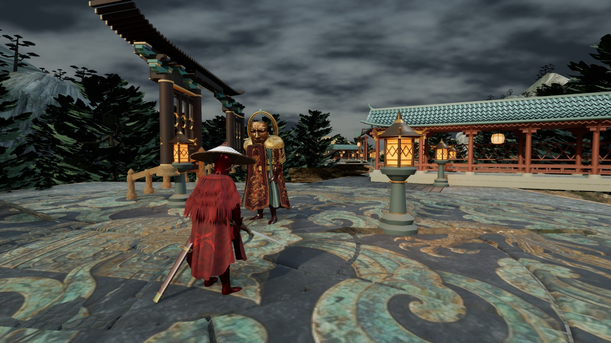
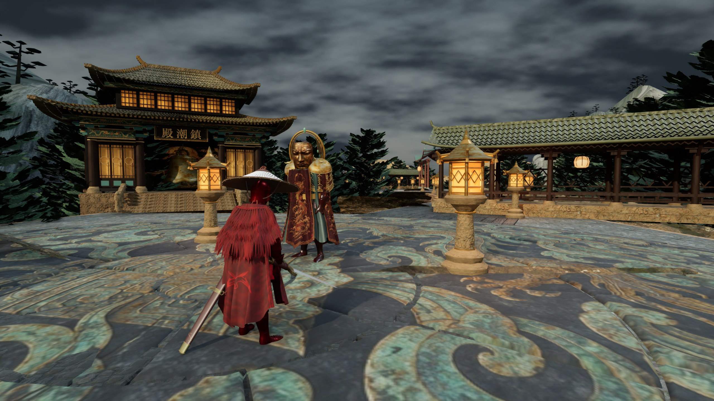
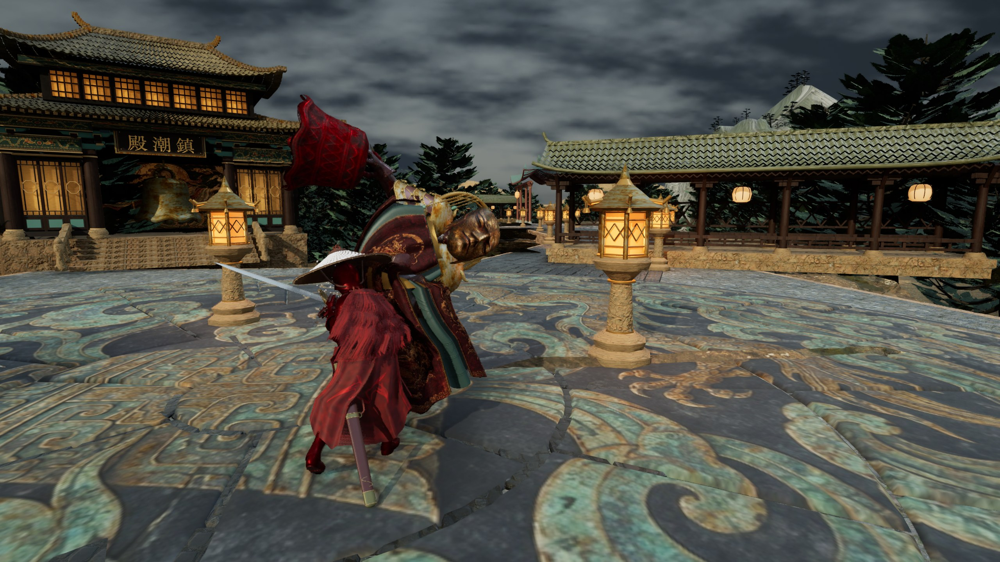

# Bell hall on the mountain route

Unreal Editor 5.8.4 running in standalone game mode, Windows, RTX 5080. The two approach images use the same player position and camera rotation. The previous engine capture is 1600 × 900. The new frames are 2560 × 1440, converted to JPEG for publication.

| Previous court | Completed bell hall |
| --- | --- |
|  |  |

A suspended casting, yoke, painted screen and inscribed tablet sit behind the original timber front. Two tiled hip roofs rise above the clerestory. Recessed side windows turn the corners onto the stone terrace. The launcher generates the architecture locally from the source geometry and existing artwork. The terrace and timber walls have collision. [View from the cleared court](court.jpg)

In the [1440p combat sample](combat.json), the test driver entered the court, used the playable pilgrim's evasive step and attacked through the enhanced input system. The boss reached zero HP at 22.05 seconds. The pilgrim retained 10 HP. The median callback interval from the first attack window through victory was 16.74 ms, with a 19.05 ms 95th percentile. The 60 FPS cap, synchronous screenshot readbacks, and a 125 ms maximum interval limit the interpretation of those timings.

The [separate continuous gameplay recording](duel.mp4) covers approach, melee and victory in the same build at 1280 × 720. It captures the game window with its health bars. It has no audio. Frame timing follows capture timestamps.
