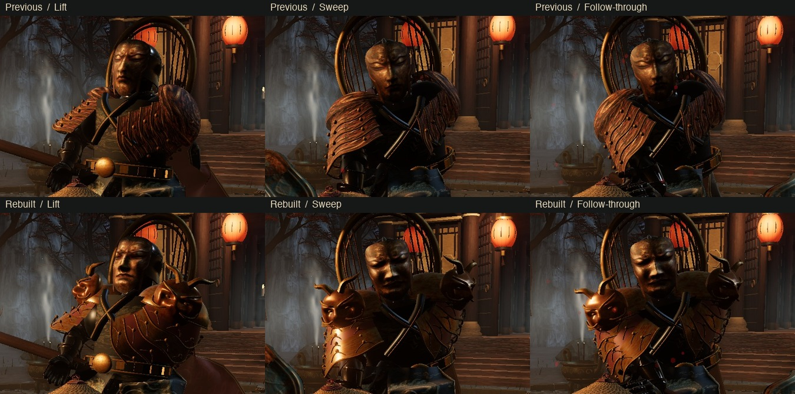

# The Bellwarden’s articulated regalia

The upper row uses `0c8629e` and the lower row uses `db4e728`. Both are cropped from 1920 × 1080 production gameplay on Apple M1 Max in Chrome. The simulation steps, approach, sword input, lens and crops match across revisions. [Lift](lift.jpg) · [Sweep](sweep.jpg) · [Follow-through](follow-through.jpg)

The collar bears a horned bronze crown. The four plates underneath open by different amounts as each upper arm turns to hold the bell shaft. Tapered horns, raised brows, arch-shaped borders and rivets are geometry. The boss mask now has recessed eye sockets, a projecting nose and shaped lips and cheeks. The back panels gather towards the waist and open towards the hem. Their lining combines the dragon brocade with a woven lozenge pattern.

The 30.2-second Pilgrim duel keeps the normal gameplay camera, health display and stereo sound. Automated keyboard input takes the fight through the awakened phase to the victory screen. The result records four parries and zero hits taken. A separate playthrough checks all three courts. [Full fight](duel.mp4) · [Recorded result](duel.json) · [Three encounter results](clears.json) · [Playable build CI](https://github.com/lzongren/vesper-hollow-tide/actions/runs/43605694525)
