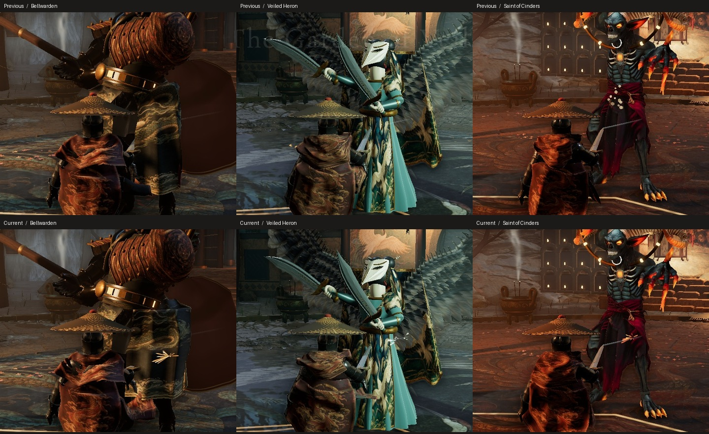

# Sword contact in three courts

The top row uses game revision `235429b`. The bottom row uses `79369f3`. Each pair follows the same approach, lock-on camera and light-attack input on Penitent. The frames come from Chrome on an Apple M1 Max at 1920 × 1080. For the paired stills, the capture driver advances the game at fixed 60 Hz increments. Each pair ended with the same change to the visible boss health bar.

| Court | Hit response | Boss health after the light strike |
| --- | --- | --- |
| [Drowned Belfry](belfry.jpg) | The jian throws thin brass sparks with a short bronze ring. | 96.129% |
| [Garden of Veils](garden.jpg) | Shorter pale chips drop quickly with two high ceramic notes. | 96.6667% |
| [Ashen Reliquary](shrine.jpg) | Orange embers linger past the blade with a low impact and a delayed scrape. | 97.2093% |

The material response is selected by opponent. The origin follows the posed blade and an approximate body surface. On the Bellwarden this can place metallic sparks on the embroidered apron. The pale chips also have little contrast against the Heron's costume.

[Three live strikes with stereo game audio, 12 seconds](contact.mp4) · [Bellwarden detail](brass.jpg) · [Recorded hit results](inputs.json)

The movie records real-time gameplay on Pilgrim through the regular encounter menu. It contains one exchange in each court. Chrome captured the game audio and frames, which were encoded at 1280 × 720 with 48 kHz stereo AAC. In a separate playthrough all three encounters reached their second phases and ended in victory. Defeat and retry were exercised separately in each court.

[Three victories and frame timings](clears.json) · [Defeat and retry results](retries.json) · [CI for the captured game revision](https://github.com/lzongren/vesper-hollow-tide/actions/runs/43596466913)
