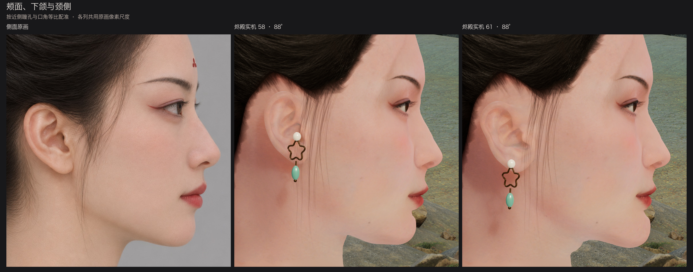
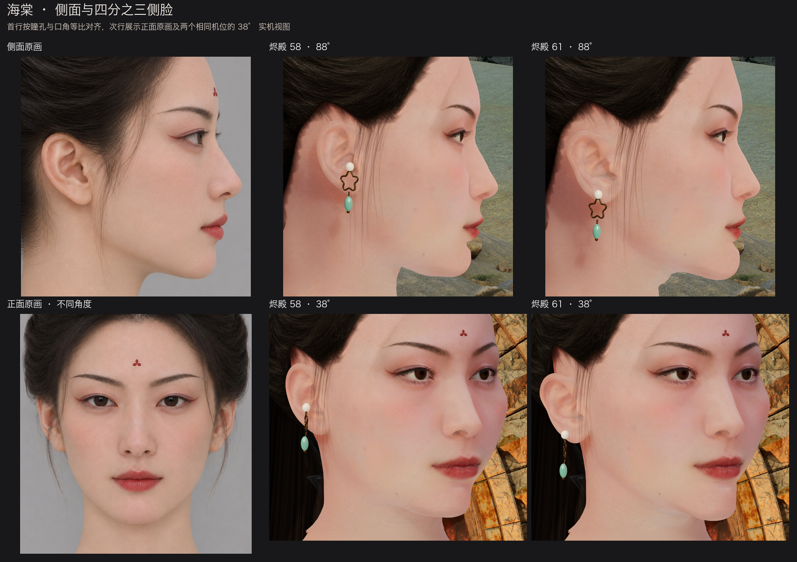
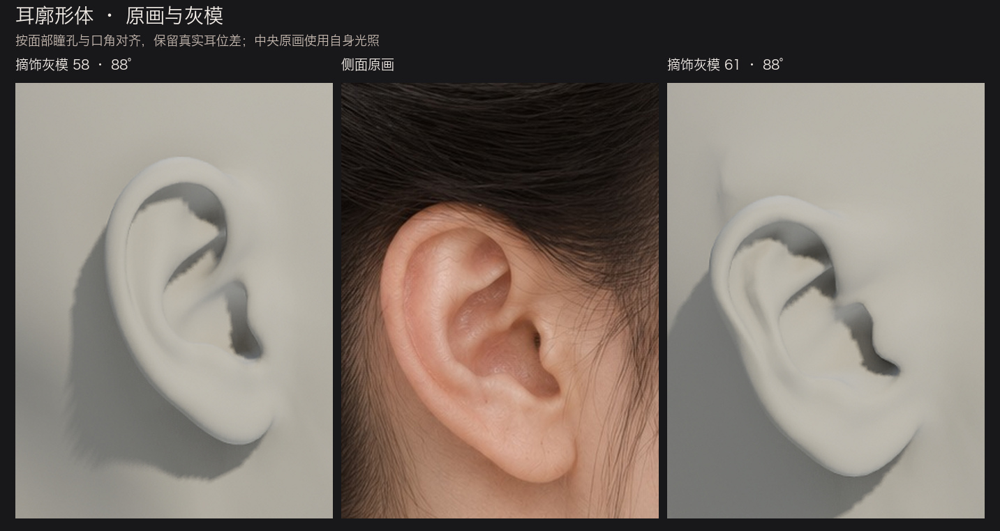

# 海棠 · 下颊、下巴和耳廓（58 → 61）

[烬殿同机位同步转面 · 12 秒](face-orbit.mp4)　｜　[耳廓、后颊到颏尖的跟随近景 · 12 秒](ear-orbit.mp4)

**脸为什么显圆？** 原来的颏尖偏后，颊肉下缘又和颈部连成一片。第 61 版保留了高处的颧骨，收进颧骨下方至耳前的软组织，补足颏垫的前突，让下巴底面逐渐转向颈部。按近侧瞳孔和口角等比对齐，在 1254 像素宽的原画上，从唇下到颏尖取 12 个横断位置，前缘到原画的平均横向距离由 30.0 降至 8.2 像素。在颏尖的两个截面上，旧版相差 25、26 像素，新版均相差 3 像素。唇下仍略退，越靠近颈部的那段线也仍偏直。

[看下颌底面与颈部交界](jaw.jpg) · [看 60° 机位](turn60.jpg) · [看完整侧面对照板](profile.jpg) · [看正面](front.jpg)

**耳廓与耳饰。** 上耳轮向后下方移，耳垂也回到原画的位置。耳轮、对耳轮分叉、耳甲腔改在三维网格上，并由软骨自身遮挡生成耳窝的局部明暗。两边的耳钉现在分别贴合各自的耳垂。灰模隐藏了头发和耳饰，保留烬殿的光；中间的原画使用它本身的光照。按整脸对齐而非单独对齐耳朵，外耳轮顶部到原画标记的距离约由 67 降至 8 像素（人工标点的不确定度约 6 像素）。耳垂高度相差约 3 像素。耳甲腔内缘的暗部仍偏硬，对耳轮分叉比原画平。

[看带饰耳廓](ear.jpg) · [看两机位的整脸灰模](clay.jpg)

**如何看转面。** 左边是 58 版，右边是 61 版。两边各有 360 张原生 Unreal 游戏视口截图，均取自 RTX 5080 上的烬殿。两版的镜头、高度、人物待机姿势与表情时序相同；固定侧面为 88°，转面从 −12° 到 116° 再返回。带饰和灰模静帧来自同一游戏进程。转面中火光独立变化；每秒 30 帧是影片播放速度，不代表实时性能。没有为照片或影片单独重画脸部阴影。原画颊面转向下颌时的暗部比实机更明显。

[轮廓与灰模读数](measurements.json) · [耳部定位、耳钉和耳窝明暗](ear-review.json) · [导出网格核验](native-mesh.json) · [同步转面核验](recording.json) · [三庭实机结果](game-check.json) · [上一轮：额顶弧线与鬓发](../crest-and-tendrils/)

在 Windows 项目内运行 `Scripts\play_pilgrimage.ps1 -CheekStudy -HeadStudy -Turntable` 可以在烬殿重看当前可玩模型。UE 缓存使用本地 AppData。
