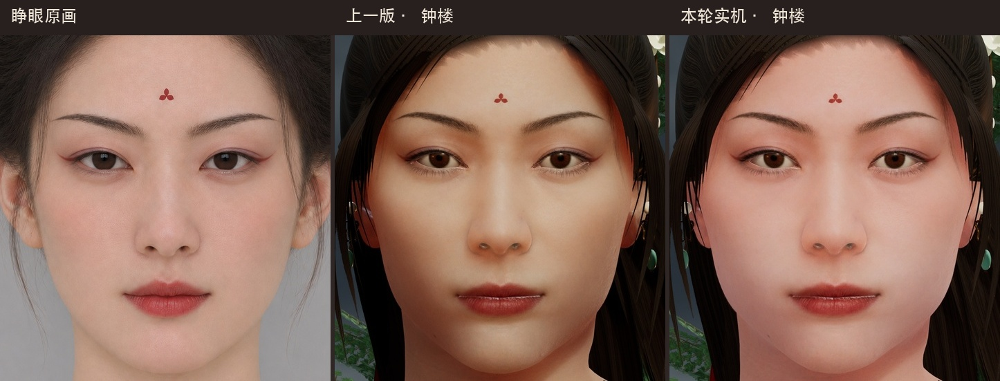
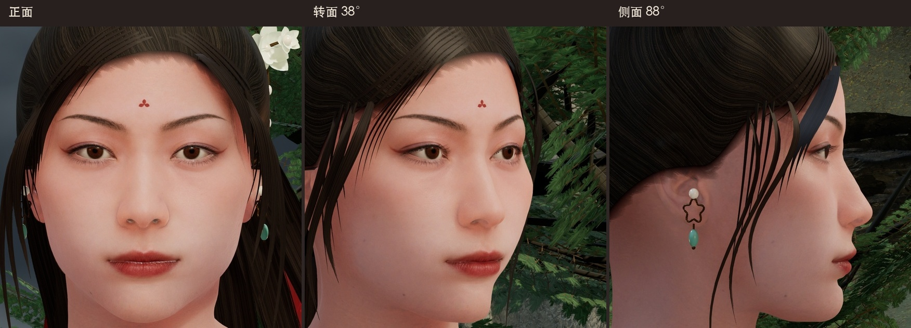
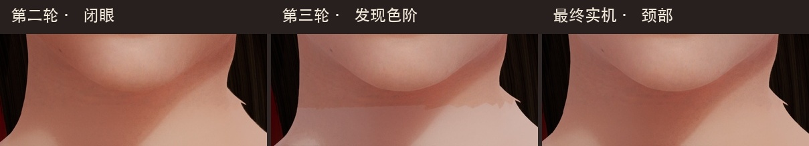
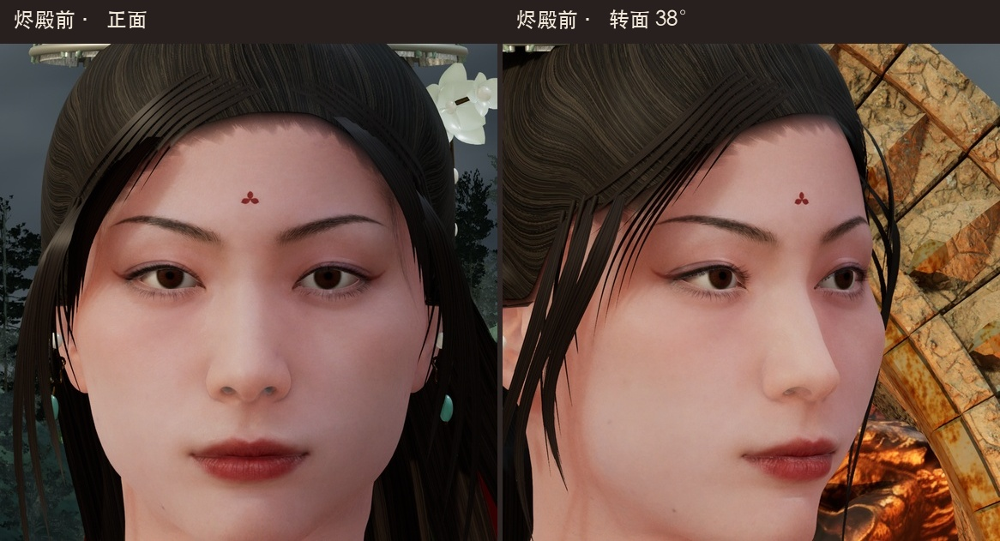

# 海棠的面颊与肤色

原画与两张钟楼实机截图按瞳距等比例裁切。前后两版使用同一关卡位置、镜头、朝向与表情。截图保留游戏的光照与材质。

[实时转面录像](turntable.mp4) · [钟楼正面原帧](open.jpg) · [38°](turn.jpg) · [88°](profile.jpg) · [闭眼](closed.jpg) · [张口](jaw.jpg)

## 三轮打磨

第一轮在头部中性网格上增加颧下与口角外侧的软组织体积，形变朝两侧和前方缓慢衰减。重算法线后导入游戏，检查了闭眼、张口及转面。独立视觉评审在 38° 确认颊部弧线连续，正面口角外侧的脸宽已接近原画。第一轮减轻了旧版的黄褐色，内颊却偏冷粉，外颊仍显暗红。

第二轮在同一机位实测六档模拟石面反光的强度。高档压平了颧骨和鼻梁的明暗。先试用每盏 0.85 lux 的暖白漫反射补光，钟楼面中亮度已接近原画，38° 转面仍能看出亮颊到棕红色脸侧的突变。

第三轮将两束补光移向更侧面，改用接近中性的颜色，每盏 1.08 lux。光向固定在世界空间。根据原画校准颧部和颊下的反照色，降低高颊亮度，逐渐减弱外侧颊下的橙色。校色区随三维表面与表情移动。普通战斗与复拍使用同一套角色、材质和灯光。

复核闭眼和张口时发现，裸颈原本从面颊贴图取色，新增的颊下校色也改变了裸颈，形成一道横向色阶。最终将身体材质改为单独采样基础肤色。构建中比对了两份 JPEG 的 SHA-256，最终面部与第三轮相同，身体与第二轮相同。

终审逐张复核了最终五个姿态。正面和 38° 的颊部都保留了连续弧度，闭眼和张口的颈部色阶已消失。烬殿侧光下仍能看清脸的转折。原画的颊面有更细的局部色差，实机深下颌偏暗，鬓角发片边界和张口时一侧后牙的反光仍较明显。

## 固定机位测量

| 读数 | 原画 | 上一版 | 第一轮 | 第二轮 | 最终实机 |
| --- | ---: | ---: | ---: | ---: | ---: |
| 颧部宽度（瞳距） | 2.228 | 2.153 | 2.181 | 2.168 | 2.197 |
| 口角外侧的脸宽（瞳距） | 1.926 | 1.887 | 1.928 | 1.902 | 1.937 |
| 六区平均色差 ΔE76 | 0.00 | 13.89 | 10.61 | 7.84 | 4.20 |
| 面中亮度 L* | 67.6 | 57.9 | 63.9 | 67.8 | 69.8 |
| 颊下亮度 L* | 68.8 | 52.2 | 55.8 | 61.7 | 66.3 |
| 下颌亮度 L* | 68.5 | 42.9 | 45.0 | 53.4 | 58.3 |

瞳距取两眼虹膜中心距离。关键点检测随明暗略有波动。第二与第三轮保留第一轮的网格形状。各肤色读数先在额、颧、面中、颊下、下颌、颏部取双侧小块 sRGB 像素的中位数，再转为 D65 CIELAB 并取两侧均值。每一块相对瞳心的位置、取样半宽和三通道实测值可查看[完整读数](review.json)。色差衡量同一机位下成片与原画的差距，也受关卡照明影响。

最终材质的首次三庭自动验证在烬圣剩余 3 点生命时达到 290 秒时限。下方战斗记录来自同一材质的重跑。

Windows 本地运行 `native\Scripts\play_pilgrimage.ps1 -PortraitReview` 可复拍钟楼五个角度与表情。用 `-ShrinePortrait` 可复拍烬殿前的正面和 38°。默认启动即进入普通战斗。[角色构建记录](build.json) · [三庭战斗记录](three-courts.json)
