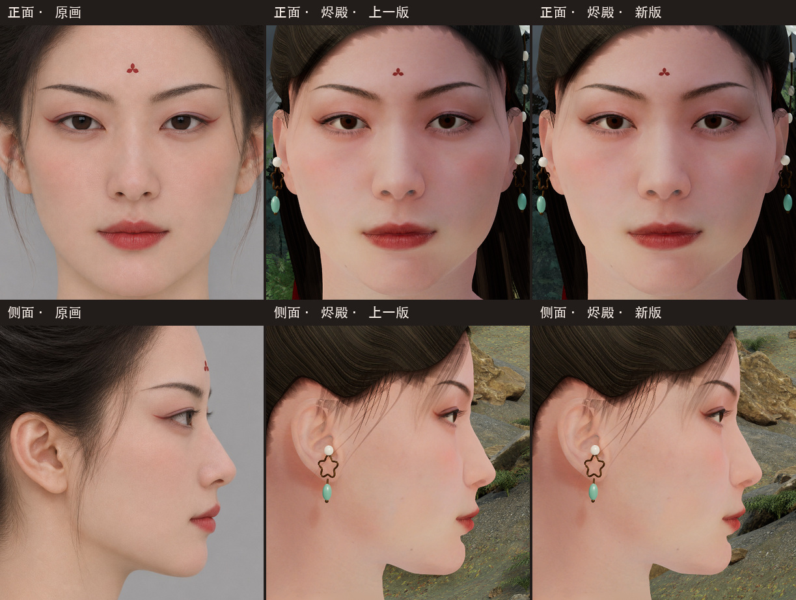
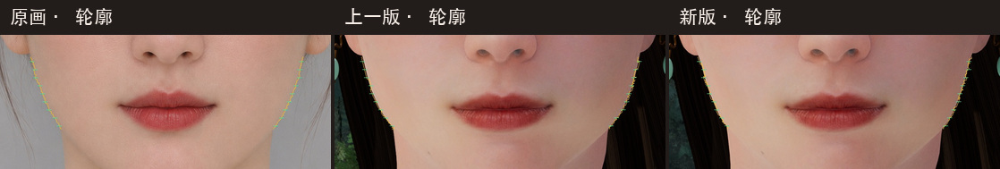
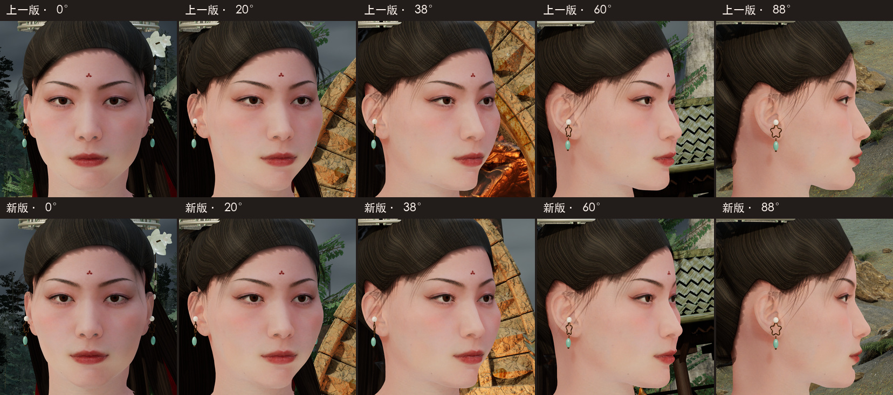
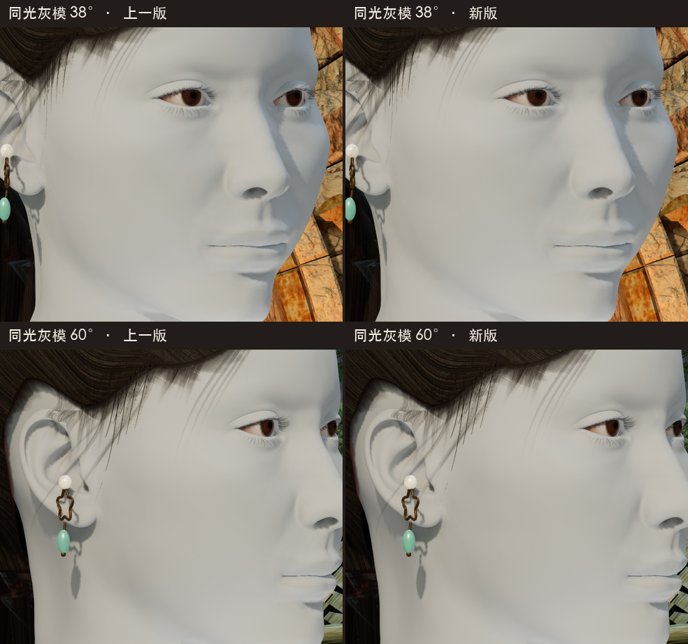
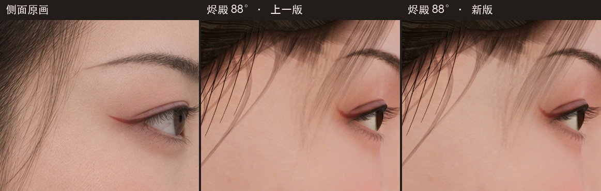
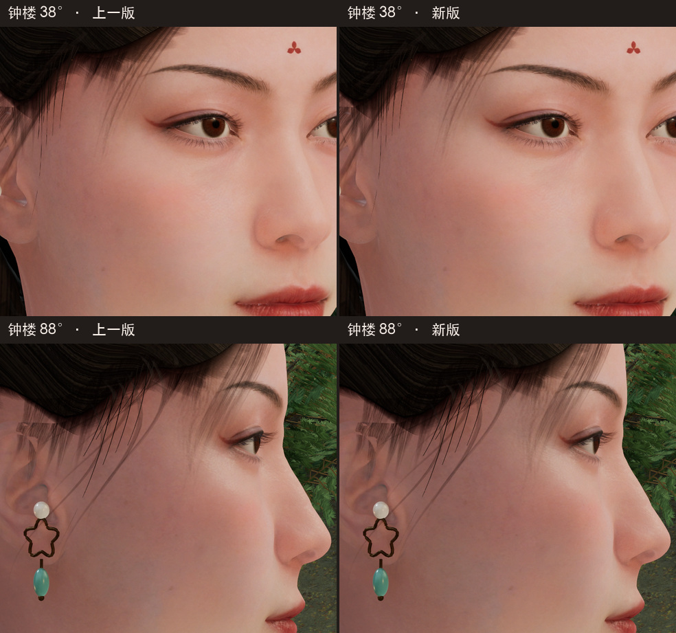

# 海棠 · 从正面转到侧面的颊型与鬓角

[烬殿同机位实机录像，10.7 秒](orbit.mp4)。左边为上一版，右边为新版。两段素材分别录自 RTX 5080 上的 Unreal 独立游戏窗口，使用正式角色、相同的烬殿位置与头骨相对机位。并排时按脸部与场景的边缘匹配实际录制帧，火焰和场景动画各自运行。



正面对齐双瞳后，下颊最宽处向内收了约 1.5 毫米。转到 38° 时，决定颊部外形的是更靠近嘴角前方的一段曲面。这段软组织往前补了最多 2 毫米，转面时亮部从颧前逐渐接到中下颊。用七个高度的下颊切片比较原画，每条先取左右半宽的平均值，再汇总绝对误差。半宽误差中位数从瞳距的 **2.33% 降到 0.33%**。同一新几何的另一轮实拍读数为 0.83%，两次均在 1% 以内，截图的轻微姿态与边缘采样会影响小数。正面与侧面对照了项目原画，20°、38° 和 60° 用于检查实际转面的连续性。







灰模采用正式的角色网格和同一块中性灰皮肤材质。两版固定在同一段待机动画的 0.24 秒，分别在 38° 和 60° 取景，逐组核对了相机的位置和旋转。

### 眉尾到鬓根的肤色

鬓角上缘的暖色主要集中在眉尾后上方。前视与侧视露出两块相邻的皮肤，校色分别沿头部表面渐消。第一轮后，侧面中段略亮、正面眉尾仍偏红；第二轮压回中段明度，单独调整前方的暖红。下面的 a* 越高表示越红，数值来自配准后裸露皮肤的小块中位数。

| 原画与实机对应部位 | 原画 a* | 上一版 a* | 新版 a* |
| --- | ---: | ---: | ---: |
| 88° 鬓角上缘 | 10.9 | 15.2 | 11.5 |
| 88° 鬓角中央 | 12.0 | 14.5 | 12.3 |
| 正面 · 画面左侧眉尾后方 | 13.2 | 15.6 | 13.6 |
| 正面 · 画面右侧眉尾后方 | 13.3 | 15.2 | 12.9 |





钟楼复拍采用游戏里的另一组光线。88° 的鬓角中央红度从 18.5 降至 16.2，相邻颧点为 21.8 和 21.4，保留了暖光下的颊色。20° 时有半透明鬓发经过眉尾后方，该角度的最终画面还包含发丝的颜色。[逐区测量与轮廓读数](measurements.json)

在 Windows 项目根目录运行下列命令可以复看转面。转面结束后会依次停在 0°、20°、38°、60°、88° 和 116°。

```powershell
.\Scripts\play_pilgrimage.ps1 -CheekStudy -Turntable
```
