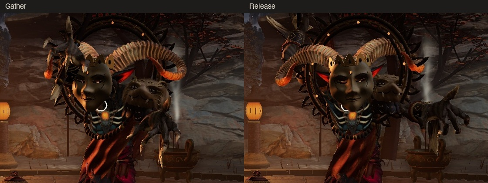

# The Saint’s casting hand and bronze guards

The left hand fans its four digits during a windup and draws them in at release. The morphs move the existing skin and horn before skeletal animation. The staff hand keeps its grip. A bronze beast face, rolled edges, dark lacquer scales and bound bracers follow the upper arm and forearm on each side. Narrow bands of heat remain at the nail beds. Reflected light defines the horn tips and the creased hide.

The comparison follows the same approach, light attack, casting pose and lateral turn at 1920 × 1080. The upper row uses `fc8790a` and the lower row uses `986bd5a`. Full frames retain the HUD and normal lock-on view. [Three matched poses](comparison.jpg) · [Shrine frame](shrine.jpg) · [Turn](turn.jpg)

The 50.5-second recording follows an entire Pilgrim fight through awakening and the victory screen. Automated keyboard inputs produced three parries and five hits taken. Chrome on Apple M1 Max captured stereo game audio and a 16.7 ms median frame interval, with a 50.1 ms 95th percentile during recording. The mask and horns remain visible as the hand crosses the chest. The outer shoulder scrolls lose detail in backlight. [Continuous fight](duel.mp4) · [Victory and frame timing](duel.json) · [Build CI](https://github.com/lzongren/vesper-hollow-tide/actions/runs/43602886067)

A separate chapter run cleared all three awakened fights. The retry run entered each encounter again at full health after defeat. [Three victories](clears.json) · [Defeat and retry](retries.json)
