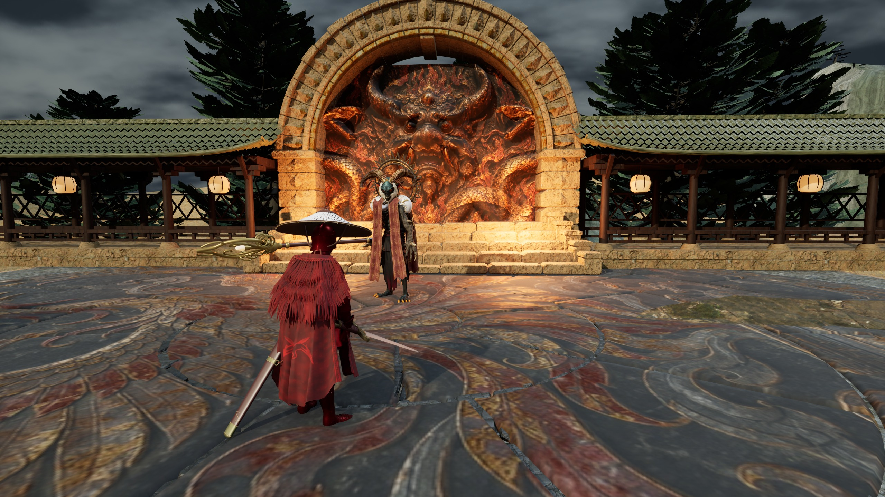

# Saint of Cinders

The third court ends at a shrine cut into the mountain. A bronze guardian and two dragons rise behind the Saint. His head, red brocade stole, arm guards and six-ring staff follow his combat skeleton. A low bell sounds as he marks the ground under the player. The mark stays where it was cast. A separate attack sends an inscribed ring out from his feet. At close range he strikes with the staff.

[The same approach before the shrine dressing pass](before.jpg) · [Falling Prayers eruption](falling-prayers.jpg) · [Expanding seal](absolution.jpg) · [Staff at close range](staff.jpg)

These are full-frame 2560 × 1440 screenshots from the standalone Unreal Editor game on a Windows RTX 5080. For the isolated duel, the test places the possessed player at the shrine entrance. The player closes on the Saint, attacks and evades using the normal combat logic. The first defeated sample occurred at 24.23 seconds with 10 HP on the player. Of 1,111 sampled tick intervals during combat, the median was 16.78 ms and the 95th percentile was 20.26 ms with a 60 FPS cap. Screenshot readbacks occur during this run. [Victory trace](victory.json)

In the independent defeat trial, the stationary player died during an eruption at 15.14 seconds. At 18.45 seconds the game had reloaded the map with a new player at the original spawn and 10 HP. [Defeat and respawn trace](defeat.json)

The continuous 1280 × 720 game-window recording includes the approach, the three attacks and the cleared court. Its 706 captured frames retain their original timestamps across 43 seconds. The recording is silent. [Watch the encounter](saint.mp4)

In a separate uninterrupted run from the mountain spawn, the controlled player walked the stone causeway and defeated the Bellwarden at 21.93 seconds, the Veiled Heron at 61.20 seconds and the Saint at 98.91 seconds. The test used movement, attack and dodge inputs throughout. [Three-court traversal and combat trace](three-courts.json)
