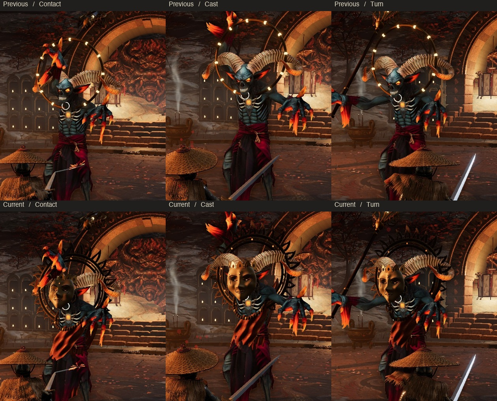

# Saint of Cinders

The frames show sword contact, a cast and a lateral turn in the shrine. Both rows use the same inputs, lock-on camera, 1920 × 1080 viewport and fixed 60 Hz simulation step. The top row uses `2fb0caa` and the bottom row uses `f7d0938`. The full frame retains the HUD and the player’s normal view. [Full gameplay frame](shrine.jpg)

The bronze face has modeled brow ridges, cheeks, eyelids, lips and a broken gilded surface. A pierced mandorla surrounds the horns. A lotus-patterned madder stole folds over the shoulder, with prayer beads at the neckline and three fabric panels hanging from the hips. The face follows the head when the Saint recoils. Its ember inlays brighten during a cast and hold a stronger glow during the awakened phase.

The 49-second recording follows a complete fight on Pilgrim difficulty in Chrome on an Apple M1 Max. Keyboard inputs were automated. The game reached victory with three parries and four hits taken. The recording uses real elapsed time, the normal camera, the combat HUD and stereo game audio. [Watch the fight](duel.mp4) · [Victory and frame timing](duel.json)

The dark side of the mask loses fine detail during lateral movement. The underlying horns, anatomy and claws retain the earlier character design. These captures document the browser build. [Verified build](https://github.com/lzongren/vesper-hollow-tide/actions/runs/43600487219)

All three fights reached their awakened phase and the chapter ending in a separate run. The defeat and retry checks exercised each court. [Three victories](clears.json) · [Three retries](retries.json)
