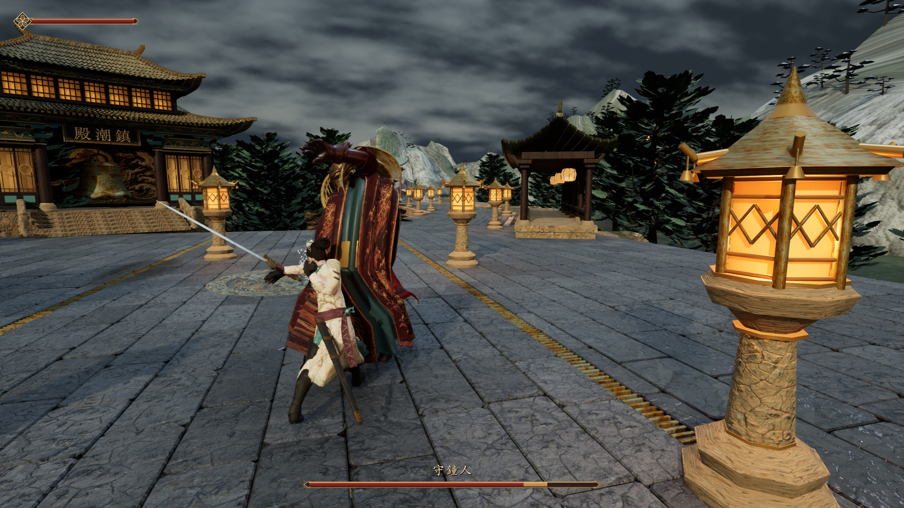

# Health in the three courts

The swordswoman’s life sits beside a magnolia seal in the upper left. When a court guardian engages, its name and health appear along the lower edge. Red lacquer follows the actor’s health, with a short gold trail for the most recent damage. Leaving range clears the enemy rail. Defeating the guardian drains the rail to zero and fades it over the following second.

[Approach](approach.jpg) · [Bellwarden](Bellwarden.jpg) · [Veiled Heron](VeiledHeron.jpg) · [Saint of Cinders](CinderSaint.jpg)

These are full viewport captures with the in-game interface enabled. The 2560 × 1440 run used the standalone Unreal Editor game on an RTX 5080. The [three-court probe](../../../native/Scripts/probe_three_courts.py) accepts `-CourtHUDReview` to capture each guardian after it takes damage. The [combat trace](three-courts.json) records the uninterrupted route.

The third guardian also defeated the player in a separate run. The [injury](injured.jpg), [fatal hit](fallen.jpg) and [respawn](respawn.jpg) frames show the player rail at 70%, empty and full. The old guardian rail disappears at spawn. The [death and travel trace](defeat.json) records the new pawn. Measurements of strip width in the [three court screenshots](route-ui.json) and [respawn sequence](respawn-ui.json) agree with the actor health fractions to within 0.2 percentage points.

The texture originals and [ornament generator](../../../art/court_lifebars.py) are included. To regenerate the PNGs, pass a Chinese calligraphic font to the generator with Pillow installed. Running the game uses the supplied textures.
