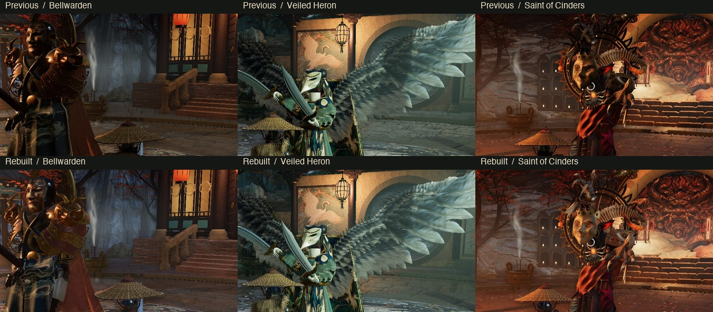

# Light in the three courts

The top row uses `2c48a52` and the bottom row uses `1d36c34`. The browser renders each at 1920 × 1080 on an Apple M1 Max. Camera, keyboard input, simulation steps and crop coordinates match each pair. The belfry view follows a sideways step after striking. The other two views show sword contact. [Full belfry frame](belfry.jpg) · [Full garden frame](garden.jpg) · [Full shrine frame](shrine.jpg)

Each arena uses its own captured light. The Bellwarden’s metal picks up the illuminated hall, the Heron’s silk reflects the pale water court, and the Saint’s mask catches both the shrine fire and the cool open sky. A rectangular source represents light entering from the open side of each court. This gives a moving arm or weapon a broad highlight while leaving the recesses between its fittings dark.

The panoramic captures are linear HDR images taken 2.15 m above the court, with combatants and HUD excluded. The renderer prefilters the map for the different material roughnesses. Each court samples a single stationary environment. Dynamic direct lights and the existing planar water reflections still respond to combat. The far valley blends into a separate vaulted sky. [Tone-mapped contact sheet of the three HDRs](probes.jpg)

To regenerate an HDR, run the development server, open `art/court-radiance.html?court=belfry`, `?court=garden` or `?court=shrine`, and save the offered file in `public/textures`. The capture starts with the moonlight source map so an earlier bake cannot illuminate its own replacement. The game loads the selected baked map when entering that encounter. The HDRs can also be used as lighting references in the native project. Native import and rendering remain unverified.

The 49-second shrine fight uses automated keyboard input, the normal gameplay camera and stereo sound. It reaches the awakened phase and the victory screen with three parries. [Complete duel](shrine.mp4) · [Combat result](duel.json) · [Game build CI](https://github.com/lzongren/vesper-hollow-tide/actions/runs/43606763795)

A separate high-quality run cleared all three encounters. The fight-only 95th-percentile callback intervals were 18.3 ms in the belfry, 18.1 ms in the garden and 25.5 ms in the shrine. The previous revision recorded 18.3, 18.2 and 21.0 ms respectively. Each revision has one observed run on this machine, so the timings do not isolate the cost of an individual change. [Current chapter results](clears.json) · [Previous chapter results](../bellwarden-regalia/clears.json)

On the Performance setting, a defeat and retry in each court returned the player to full health. The session requested just the three court HDRs, once per court. [Retry and HDR request log](retries.json)

The sky texture was generated with built-in ImageGen. [Production cloud texture](../../../public/art/clearing-clouds.jpg)

Cloud texture prompt

Original photoreal sky texture for a real-time 3D game, a square upward-looking wide-angle photograph of the entire cloud ceiling at blue hour during a clearing mountain storm. Camera aimed directly at the zenith, sky in all four corners. Deep slate blue charcoal, broad sculptural monsoon cloud banks transitioning into delicate torn silver wisps and a soft luminous gap offset towards the top right. Rich tactile internal cloud volumes and cool reflected moonlight, a tiny wash of muted peach from the horizon, restrained dynamic range with readable dark detail. No horizon line, landscape, mountain, trees, moon disc, stars, objects, text, frame or borders. A real atmospheric cloud field with quiet areas, naturally asymmetrical, no circular vortex or radial pattern. For mapping in world XZ space onto the vaulted sky of a late-Ming mountain courtyard.

