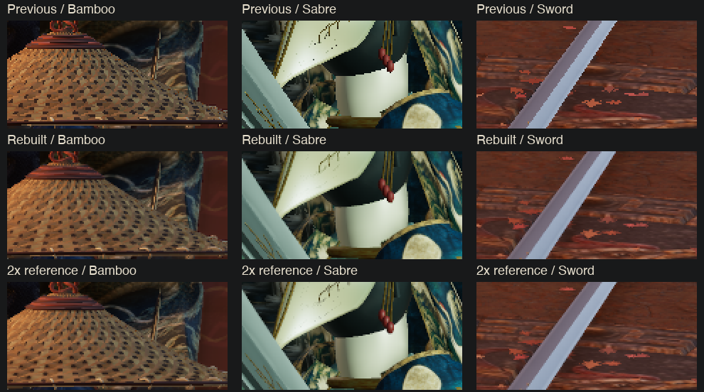

# Edge coverage during combat

The three columns show the woven brim, the Heron’s crossed blades and the pilgrim’s sword. Rows show the previous build, the rebuilt scene pass and a reference rendered at twice the width and height. Crops are magnified twofold with nearest-neighbour sampling. [Bellwarden](court-0.jpg) · [Veiled Heron](court-1.jpg) · [Saint of Cinders](court-2.jpg)

The high-quality renderer now resolves multisampled geometry in a linear half-float HDR target before applying court occlusion, fog, bloom and tone mapping. The shader-based edge filter follows tone mapping on devices that lack a shared color/depth sample count. The low-quality renderer keeps its direct canvas path. An RTX 5080 probe observed four RGBA16F samples at 2560 × 1440 and after a resize to 1400 × 850. A separate M1 Max run verified four HDR samples across a resize and a completed frame under an injected empty HDR sample list.

[Motion comparison](duel.mp4) shows the original on the left and the rebuilt version on the right. Both use the same lateral movement, attack and dodge inputs in the playable Heron encounter. The 3.8-second silent clip shows identical 940 × 752 crops of 2560 × 1440 Windows frames, sampled every second simulation tick.

## Reference comparison

All captures use Edge on an RTX 5080. For each court, six frames along the same 16-tick traverse were compared with an independent 5120 × 2880 render of the earlier build, reduced twofold in linear light. Each comparison covers the same central 1088 × 732 crop. The mask uses the strongest quarter of reference luminance gradients. Errors are mean absolute differences in 8-bit display RGB on that mask, averaged over six frames. Subjective art quality, animation quality and full-image similarity require separate evaluation. [Per-frame measurements](motion-metrics.json) · [First-frame regions](metrics.json)

| Court | Previous edge error | Rebuilt edge error | Reduction | Combat callback p95 | Longest interval |
| --- | ---: | ---: | ---: | ---: | ---: |
| The Bellwarden | 5.01 | 3.92 | 21.8% | 16.8 ms | 19.7 ms |
| The Veiled Heron | 13.24 | 13.19 | 0.3% | 16.8 ms | 25.8 ms |
| Saint of Cinders | 7.36 | 7.91 | -7.4% | 16.8 ms | 59.4 ms |

The six-frame mean improved in the Bellwarden court and changed little in the Heron court. It worsened in the Cinder court. The reference and measured captures ran separately, so animation or effect phase differences can also contribute. These measurements do not isolate temporal shimmer.

A separate real-time Pilgrim run cleared all three awakened bosses in succession. The previous gameplay revision is `c40e07a`; the new one is `961a02a`. All 82 release files matched across the local build, Windows runtime and CI artifact by SHA-256. [Outcomes and timings](clears.json) · [Build verification](https://github.com/lzongren/vesper-hollow-tide/actions/runs/43612232537)
