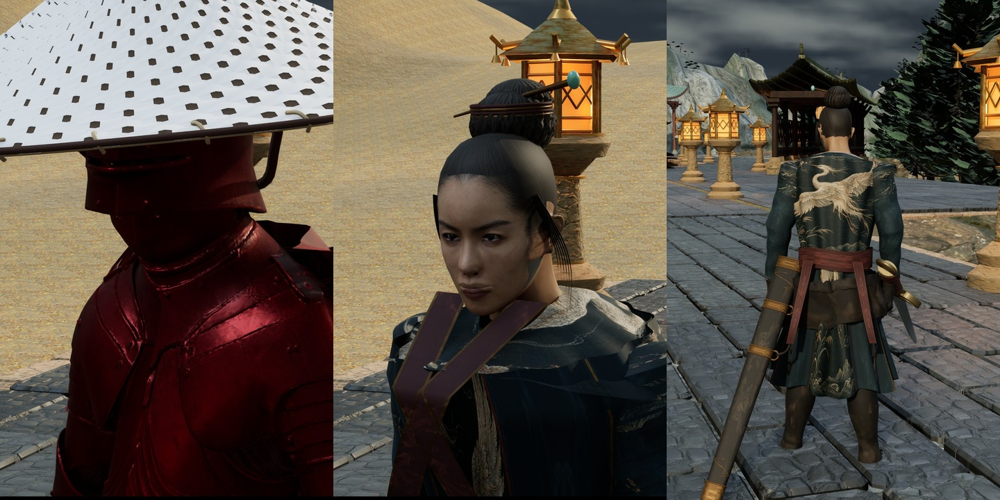

# Crane Wayfarer

The player on the mountain route now wears an indigo coat embroidered with an egret. A jade pin holds her hair above the neckline. The two skirt panels follow the thighs during movement, the fitted sleeves follow the arms, and the jian follows the weapon hand. Her face uses a projected portrait on human facial topology with separate eye surfaces. The hair and facial expression use a fixed pose.

| Camera | Previous player | Current player |
| --- | --- | --- |
| Front portrait | [Before](before-front.jpg) | [After](after-front.jpg) |
| Over the shoulder | [Before](before-rear.jpg) | [After](after-rear.jpg) |
| Three-quarter full body | [Before](before-profile.jpg) | [After](after-profile.jpg) |
| Walking | [Before](before-walk.jpg) | [After](after-walk.jpg) |

All images come from the possessed player in the standalone Unreal Editor game on the Windows RTX 5080. The comparison uses identical camera offsets, lens settings, spawn position and lighting at 2560 × 1440. The wardrobe comparison uses the approach road, away from incoming attacks. [Mesh attribution and texture sources](../../../native/Art/Wayfarer/)
