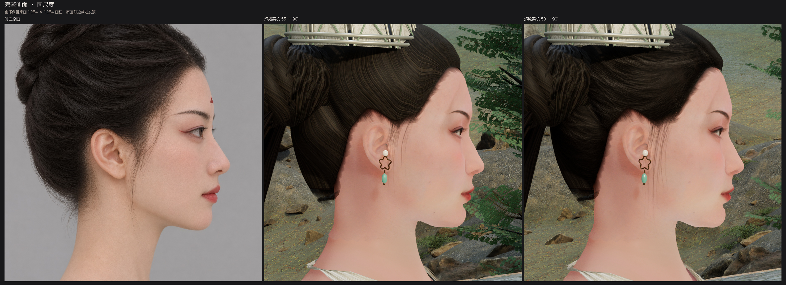
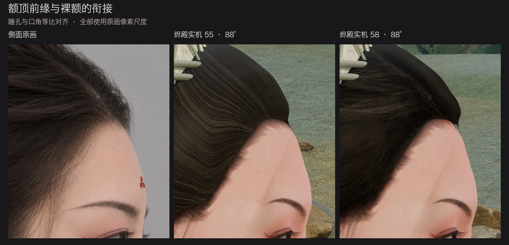
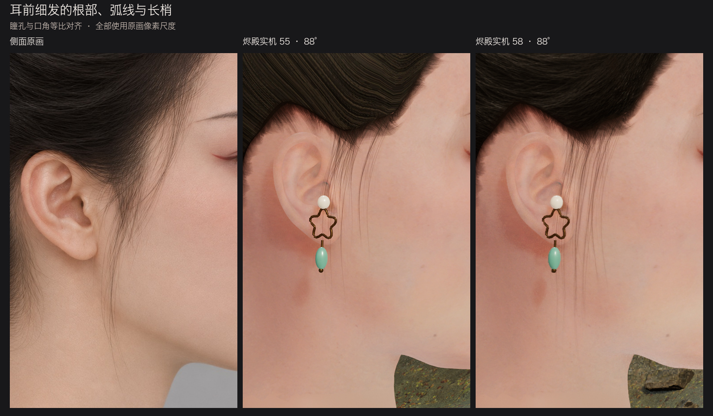

# 海棠 · 烬殿侧面与转面（55 → 58）

[两版同步转面 · 12 秒](orbit.mp4)　｜　[跟随鬓根与发梢的近景 · 12 秒](temple-orbit.mp4)

这是同一座烬殿里的可玩角色。左半边是 55 版，右半边是 58 版。原生镜头从 −12° 转到 116°，再返回起点。55 版来自游戏窗口录屏；58 版在虚幻的游戏视口沿相同轨道逐帧截图，再按每秒 30 帧播放。两种方法都保留了烬殿的原始渲染。火光和曝光独立运行，近景裁自相同的配对帧。这不是游戏实时帧率测试。为等眉眼纹理加载完整，开头 13 帧使用相同角度重新预热拍摄。



**额顶。** 55 版在发际上方先鼓再向内折。58 版补了额前发层的体积，把底部收回额头，在外层穿插逐根收细的散发。头发上的大束沿额角向后梳开，保留烬殿自己的光照。原画裁掉了头顶最高点；顶部以上仅能看两版游戏内的完整轮廓。



[放大看额顶外缘和碎发](crest.jpg) · [不裁切的 90° 游戏镜头](full-head.jpg)

以近侧瞳孔和同侧口角作平移、旋转和等比缩放。在 1254 × 1254 的原画内，沿发际上方到裸额的一段（y=100…250，每隔 10 像素）测头发或皮肤与背景接触的最外缘。16 个位置到原画的平均绝对横向距离，从 12.1 像素降到 4.5 像素。改善集中在额前中段：y=120…200 的九个位置由 14.9 降至 2.7 像素，最上方八点由 3.9 降至 3.5 像素。到 y=220、230，密发边缘还比原画偏后约 15、11 像素。原画的细发边缘也更透、更散。[取样位置](contour.jpg)

**鬓发。** 耳边保留短绒，长发束在耳垂两侧错开，两束下段分别向前、向后回弯。以各自耳垂下缘为起点，在 2560 × 1440 的 88° 实机机位上，最长的可辨暗线从耳垂下 120 像素延伸到 193 像素；等比对齐的原画能追到至少 283 像素。耳垂定位约有 ±4 像素误差，极淡的梢端也会随亮度阈值改变。这是画面中还能分辨的长度，并非单根头发的物理长度。



[以耳垂为起点查看发尾](earlobe.jpg) · [机位、采样与录像核验记录](evidence.json)

在 Windows 本地 Unreal 项目里重看同一条烬殿运镜：

```powershell
.\Scripts\play_pilgrimage.ps1 -CheekStudy -HeadStudy -Turntable
```

重新烘焙发壳纹理可从仓库根目录运行 `python art/crown_fiber_grain.py`（需 NumPy 和 Pillow）。仓库提供配准网格和烘焙结果。
