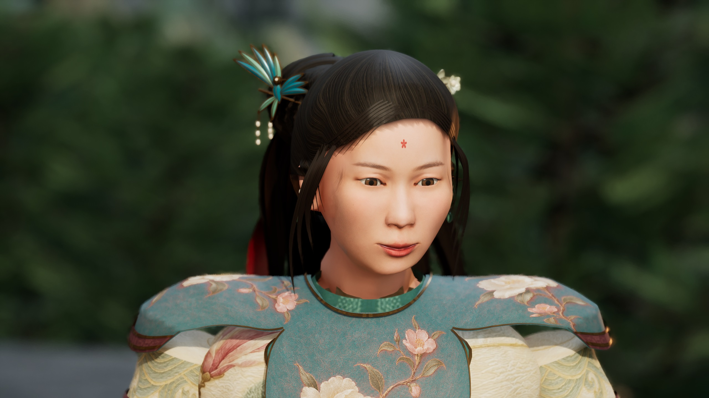

# 花钿海棠

眉间的一朵朱红海棠直接画在脸部贴图上。颊部向颧骨的过渡、眉弓和收拢的唇线都在原头部网格上调整，眼睑与睫毛保留同一组眨眼变形。角膜上的两点柔光随观察方向变化。背面低髻系着绛色暗花绦带，左右错长，转头时由头颈和上背共同带动。上臂和腕部的金线与绛线绕整圈袖身。

| 实机机位 | 本版 | 上一版 |
| --- | --- | --- |
| 山门正面 | [正脸](front.jpg) | [同机位](../jade-swallow/front.jpg) |
| 白玉簪一侧 | [侧面](profile.jpg) | [同机位](../jade-swallow/profile.jpg) |
| 发髻与衣袖 | [背面](reverse.jpg) | [同机位](../jade-swallow/reverse.jpg) |
| 持剑站姿 | [全身](dress.jpg) | [同机位](../jade-swallow/dress.jpg) |

五张定点肖像均取自 RTX 5080 上的 Unreal Engine 5.8.4 独立游戏窗口，分辨率为 2560 × 1440。镜头靠近实际由玩家控制的海棠，保留庭院光照与待机动画。[复拍机位](../../../native/Scripts/probe_plum_portrait.py) · [服装与脸部装配](../../../native/Scripts/wayfarer_outfit.py) · [结发织带](../../../native/Scripts/begonia_ribbons.py)

## 第三人称战斗

正常游戏使用跟随镜头。下列截取保留玩家血条和对手血条，可以对照角色在跑动或挥剑时占多大的画面。[守钟人](Bellwarden.jpg) · [披纱鹭](VeiledHeron.jpg) · [灰烬圣徒](CinderSaint.jpg)

同一趟自动输入试走从山门出发，使用新版玩家骨骼网格 `HuadianHaitang`。按游戏时间计，三场胜利分别发生在 24.63、62.88 和 100.67 秒。[三庭胜利、玩家位置与目标追视记录](three-courts.json)

[守钟人交手 · 9 秒原速窗口录像，含同趟游戏混音](bell-court.mp4)。录像来自另一次试走，取守钟人战中的独立引擎截图匹配窗口帧，再按该时刻对齐 48 kHz 双声道混音。这趟击败了前两名 Boss，自动输入在灰烬圣徒剩 1 点血时持续挥空，最后超时。上面的三庭通关记录来自前一趟。
