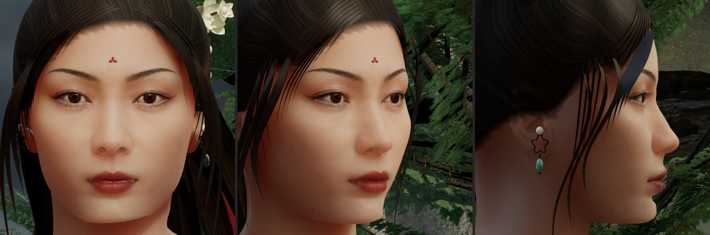

# 海棠的实时数字人头部

[12.6 秒转面录像](turntable.mp4)来自 RTX 5080 上 Unreal 5.8 的独立游戏窗口。镜头围绕同一个玩家角色从正面转到侧面再转回，途中演示一次眨眼和一次张口。录像为 1600 × 900、30 帧每秒、无声音轨。静帧原图为 2560 × 1440，取自游戏内同一个山路位置。上方拼图对三张图片做了等比例裁切。

| 游戏窗口 | 实机原图 |
| --- | --- |
| 正面与闭眼 | [睁眼](open.jpg) · [闭眼](closed.jpg) |
| 转面 | [38°](turn.jpg) · [88°](profile.jpg) |
| 张口 | [可见牙齿和口腔的近景](jaw.jpg) |

在本机仓库根目录执行 `.\native\Scripts\play_pilgrimage.ps1 -PortraitReview` 可复拍上述五个实机视角。普通启动直接进入战斗。

## 模型和动画

从 Epic Ada 样例 DNA 读取面部、牙齿、左右眼球、睫毛和内眼角的网格与蒙皮数据。先用美术侧面参考定鼻梁、唇部突出量和下巴，再用正面测量校正软组织。睫毛保留透明度，眼球在眼眶内转动。皮肤使用独立 UV、漫反射、叠加微表面细节的切线法线、粗糙度和 Unreal 的次表面散射材质。发髻和冠饰沿用现有角色资产。

本地烘焙评估原始控制量对应的关节变换和矫正形态，再把七个结果做成可玩角色的形变目标。游戏根据附近对手驱动四向注视，根据呼吸、移动和攻击动作驱动嘴和眉；眨眼有独立时序。该角色使用这七个表情通道，尚未接入面部动作捕捉或对白口型系统。

完整可玩角色的三个距离层级分别为 202,559、104,424、56,485 个渲染顶点，包含衣饰、头发和武器。两级简化保留了面部形变映射。[引擎构建记录](build.json)

## 素材与复测

[正面造型参考](../../../native/Art/Wayfarer/portrait-open.jpg)和[侧面造型参考](../../../native/Art/Wayfarer/sculpt-profile.jpg)用于雕形与妆色设计。两张参考均为美术图。两次注册所用的中间实机帧分别为[形体校准](calibration.jpg)和[材质校准](pigment-calibration.jpg)。[素材来源和重建方式](../../../native/Art/Wayfarer/README.md#digital-human-build)

用同一角色依次通过三座庭院。测试脚本通过正常移动、出剑和闪避输入推进，并读取每场战斗的生命值。[守钟人](Bellwarden.jpg) · [披纱鹭](VeiledHeron.jpg) · [灰烬圣徒](CinderSaint.jpg) · [三场战斗的连续采样](three-courts.json)

两次 1440p 三庭复测均通关。第一次游戏回调间隔中位数 19.37 毫秒、P95 58.32 毫秒。减少不产生可见位移的眼口形变提交后再次运行，中位数 17.64 毫秒、P95 40.00 毫秒、P99 64.12 毫秒。第二次采集有 410 个间隔超过 33 毫秒。采样含实机截图和场景加载，反映整段游戏回调的间隔。两次运行的缓存状态也有差异。
