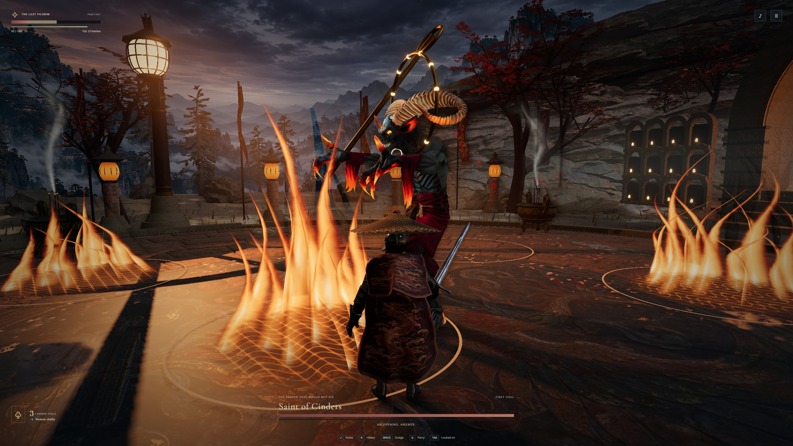

# Fire in the Ashen Reliquary

[Matched fire comparison](cinders-comparison.jpg) · [Bellwarden sweep](bellwarden.jpg) · [Matched sweep comparison](bellwarden-comparison.jpg)

The previous shrine rendered Falling Prayers as solid cones. Each vent now opens over a bed of coals. Sixteen curved sheets rise to different heights, curl, then fade as the hit window closes. Separate vents ignite in the order set by the fight. The player health readback at the end of the matched sequence was 18/100 in both builds.

In the belfry the ground material renders the sweep edge and short echoes in puddles. Dry stone preserves a narrower boundary. The sweep and slam read the same contact margins as the combat simulation. The charge path includes the boss's contact radius and shortens with the remaining travel time. Moving hazards, including feathers and the saint's expanding ring, still have independent cues.

The two foreground maples in the Garden of Veils sit farther from the outer chase-camera path. The test unlocked the camera, moved to the right and back, then locked onto the Heron again. Both wings and the player's sword remained visible at the garden rim in both versions. This comparison does not establish that foliage was occluding either fighter in normal play before the change. An older stepped screenshot showed the whole arena from overhead, with the entrance title still on screen. That runner reused its virtual clock across encounter resets. The new defeat runner rebases its clock for each entry, and the game clamps elapsed time to zero when an animation timestamp predates an encounter reset. [Garden rim](garden.jpg) · [Matched camera path](garden-comparison.jpg)

## Capture conditions

Windows Edge reported an RTX 5080 through Direct3D 11. Both builds used the normal encounter selector, keyboard controls and a 2560 × 1440 viewport. Matched stills advance the animation callbacks at 60 Hz to compare the same move. The full-size new images are unretouched. The comparisons show the previous build on the left and the new build on the right.

The fire still lacks local lighting on the player's back and nearby stonework. The ground wake reads more naturally against the inlay, but the bright circular borders of the separate shrine hazards still stand out. These are open visual issues.

In the official dungeon screenshot, the folds at the hunter's elbows and shoulders catch light while the heavier hem hangs in a broad silhouette. The shrine capture shows brocade at comparable screen size, but the player's back still forms a nearly continuous shell from the shoulders to the waist. The torch also draws a localized pool of light across uneven stones. The new coals have a distinct floor contact and the flame shapes have depth, while the neighboring architecture and actor receive little change in light as a vent opens. This comparison covers still-frame costume and lighting. [PlayStation's dungeon screenshot](https://www.flickr.com/photos/playstationblog/15829933072/)

## Combat verification

[Full Saint of Cinders fight with game audio](cinders.mp4) · [Victories and callback timings](victories.json) · [Defeats](defeats.json) · [Separate long-frame profile of the shrine](profile.json)

The recorded Pilgrim encounter goes from the opening to the awakened phase and the final victory screen. The film preserves 1351 screencast images with their original timing over 78.38 seconds (17.2 images per second). Its synchronized stereo track comes from the game's audio graph. The video clock measures wall time and the result screen measures simulation time.

An independent keyboard run cleared all three fights. A second run took damage until death in each court, selected Retry and confirmed the player had 100/100 health. The Windows build and the public CI archive for code revision 300e78c matched all 61 files.

| Encounter | Victory clock | Parries | Hits taken | 95th percentile callback interval | Longest interval |
| --- | ---: | ---: | ---: | ---: | ---: |
| The Bellwarden | 0:26 | 3 | 0 | 16.8 ms | 2.80 s |
| The Veiled Heron | 0:28 | 6 | 0 | 16.8 ms | 2.94 s |
| Saint of Cinders | 0:40 | 4 | 5 | 16.8 ms | 2.65 s |

In a separate cold shrine entry, Edge's Long Animation Frames API attributed 4.09 s to the first game frame callback during the entrance. A later 1.81 s interval during Falling Prayers reported 5.2 ms of script time and zero blocking duration. These measurements distinguish the expensive first render from a gap between callbacks in combat. The latter needs a browser/GPU trace to identify its cause.
