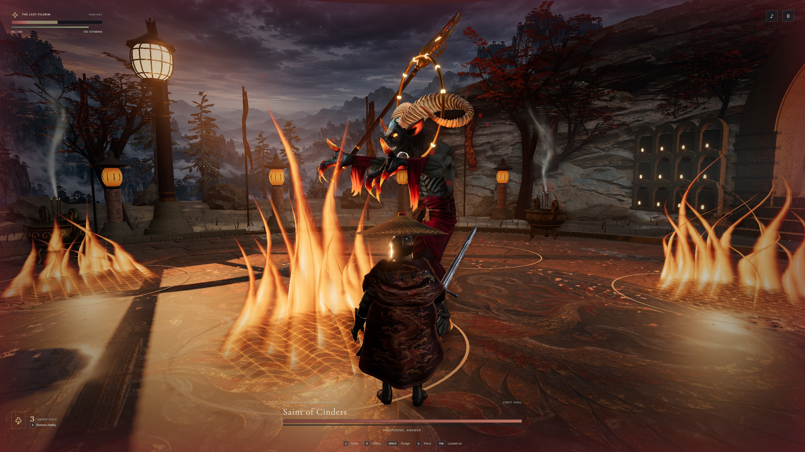

# Fire across the shrine

[Previous and current cast](firelight-comparison.jpg) · [Shoulder folds at native pixel size](mantle-comparison.jpg) · [Staff during the warning](staff.jpg) · [Bellwarden](bellwarden.jpg) · [Heron](heron.jpg)

The Saint's eruption lights the paving, the pilgrim's shoulders and the staff. Each source stays at its vent, brightens with ignition and goes dark as the fire dies. The awakened cast can ignite eight vents. The shrine keeps eight unshadowed sources between attacks to avoid a shader change on ignition. Opaque surfaces reuse the current shadow maps for ambient occlusion. Airborne effects remain visible in the main view and the water reflection.

The shoulder cape drapes in three folds between the neckline and upper arms. The folds are part of the moving geometry, so the brocade and highlights bend together. A cast lotus socket, two open bronze rails and six freely swinging hoops replace the Saint's plain ring. The two sides of the finial frame its ember. The hoops lag behind the staff tilt and metal transients sound on release and rebound. The native project includes a ten-mesh GLB of the same staff with separate ring pivots. [Native asset and import status](../../../native/README.md)

## Same-pose comparison

Both Windows builds used the shrine menu, the same approach and sidestep, and the same number of 60 Hz simulation steps. The comparison shows the previous build on the left and the current build on the right. The 2560 × 1440 captures retain the native HUD. The costume comparison crops the same 410 × 390 rectangle from both originals without scaling or grading.

In the crest frame, the stone below the right-hand vent increases from 0.009 to 0.193 mean linear-sRGB luminance (pixel rectangle 2130,1040 to 2350,1110). The pilgrim's neck rim catches the light, while the average over the patterned shoulder stays dark (0.014 to 0.012, rectangle 1190,881 to 1340,964). A distant sky patch stays within 0.001 of the previous value (rectangle 1340,15 to 1460,85). The brightest ground reflections are broad, and the dark robe still loses its layered silhouette at middle distance.

## Apple Silicon

On an M1 Max, arm64 Chrome reported the ANGLE Metal renderer and displayed all three combat arenas at 1440 × 900. In each one the tester approached, struck, observed 83 stamina, paused and returned to the menu. These were short entry tests. [Three in-game views](mac-courts.jpg) · [GPU and HUD readback](mac.json)

## Combat verification

[Full Saint of Cinders fight with game audio](shrine.mp4) · [Victories and callback timings](victories.json) · [Defeats](defeats.json) · [Separate long-frame profile of the shrine](profile.json)

The recorded Pilgrim encounter goes from the opening to the awakened phase and the final victory screen. The film preserves 1024 screencast images with their original timing over 69.94 seconds (14.6 images per second). Its synchronized stereo track comes from the game's audio graph. The video clock measures wall time and the result screen measures simulation time.

An independent keyboard run cleared all three fights. A second run took damage until death in each court, selected Retry and confirmed the player had 100/100 health. The Windows build and the public CI archive for code revision 279ed58 matched all 61 files.

| Encounter | Victory clock | Parries | Hits taken | 95th percentile callback interval | Longest interval |
| --- | ---: | ---: | ---: | ---: | ---: |
| The Bellwarden | 0:26 | 3 | 0 | 16.8 ms | 2.20 s |
| The Veiled Heron | 0:26 | 5 | 0 | 16.8 ms | 1.69 s |
| Saint of Cinders | 0:37 | 4 | 4 | 16.8 ms | 2.17 s |

The previous three unrecorded runs had longest intervals of 2.80, 2.94 and 2.65 seconds in the same encounter order. Each figure is from one run. Both revisions still stalled visibly. In a separate shrine profile the first game-frame callback took 5.48 seconds during entry, compared with 4.09 seconds in the previous profile. One later 2.04-second frame reported only 7 ms of script execution. The remaining time cannot be attributed to a specific GPU pass from this trace.
