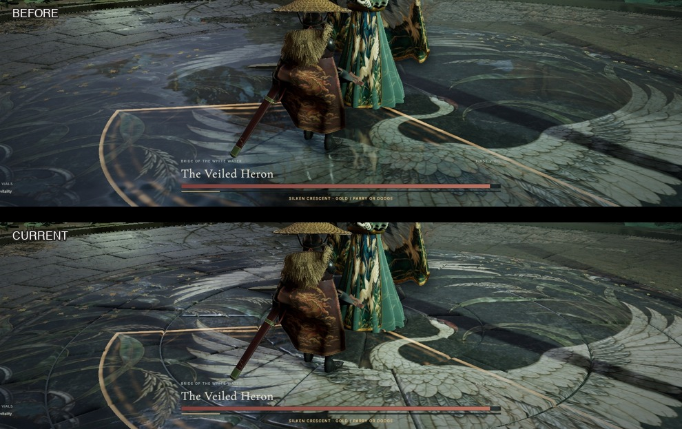

# The three court mosaics

Each disc is assembled from 82 fitted stones in six courses. The original dragon-and-bell, crane and phoenix designs run continuously across the joints. Height, worn edges and channelled water interrupt the reflected image. The upper and lower frames use identical inputs and camera settings from revisions `403cafa` and `9c98313`. Each comparison crops the same region from two 1920 × 1080 gameplay frames. [Belfry comparison](bell-comparison.jpg) · [Shrine comparison](shrine-comparison.jpg)

The stills were taken from the production renderer with lock-on engaged and fixed simulation steps for alignment. Full frames preserve the view of the court and the combat HUD. [Belfry](belfry.jpg) · [Garden](garden.jpg) · [Shrine](shrine.jpg)

The 29-second recording follows the entire Heron fight on Pilgrim difficulty, with stereo sound, in Chrome on Apple M1 Max. Automated keyboard input reached the awakened phase, landed five parries and finished at full health. The game’s attack outline follows the stone relief. Impacts disturb existing puddles. The lighting at the shrine still obscures some of the distant masonry, and the smooth areas of the Saint’s shoulders and claws remain visible at sword range. [Watch the duel](duel.mp4) · [Recorded victory](duel.json) · [Three chapter clears](clears.json) · [Playable build CI](https://github.com/lzongren/vesper-hollow-tide/actions/runs/43601520546)

Each court also returned the pilgrim to full health when retried after defeat. [Defeat readbacks](retries.json)
