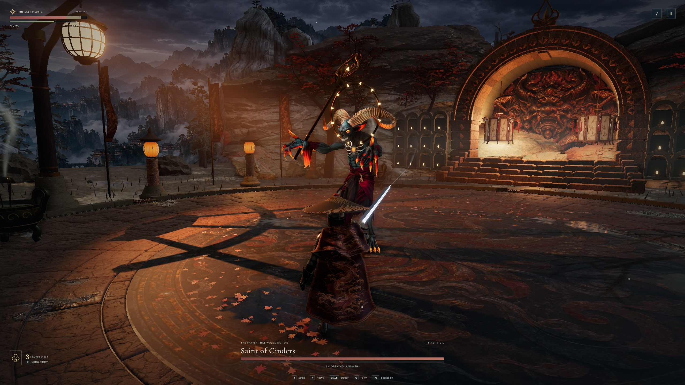

# The guardian relief in the Ashen Reliquary

[Matched heavy-stroke detail](comparison.jpg) · [Matched lateral view](crossing-comparison.jpg) · [Full lateral frame](crossing.jpg) · [Encounter opening](entry.jpg)

The shrine wall follows the original painting of a horned guardian flanked by two dragons. The brow, muzzle, fangs, horns and overlapping coils have independently shaped profiles, with up to 2.17 m of depth across the panel. Narrow highlights follow the gilt snouts and raised coils. The baked relief has 67,200 triangles, fits into one indexed primitive, and carries its albedo and metalness/roughness texture. [Runtime and native exchange mesh](../../../public/models/cinder-relief.glb) · [Source geometry](../../../art/shrine_relief.py)

The inner stone arch extends back to the panel. Two lamps hang forward of the dragons, each with a local light. Their spacing reveals the central face from the combat camera. The cast relief remains attached to a continuous backplate. The lower-left stone catches a broad, pale highlight.

The pairs were taken in arm64 Chrome at 2560 × 1440 with the same starting save and keyboard input on Penitent. The previous build is the lotus arch revision. Both sides of each pair use the same crop. In the lateral view the pilgrim has moved left. In the heavy-stroke view the pilgrim has closed distance and moved back right before attacking. Production combat and the normal HUD are active.

## Recorded combat

A separate M1 Max run captured 1,082 compositor frames, the normal HUD and 48 kHz stereo game audio. The 1280 × 720 film runs for 63.83 seconds, including the final hold. Its last decoded frame shows a Pilgrim victory in 58 game seconds with three parries and ten hits taken. The capture averaged about 17 frames per second. [Complete shrine fight](fight.mp4) · [Victory screen](result.jpg)

All 64 files in the downloadable Linux CI build matched the smoke-tested local production files by path and SHA-256. To play locally, extract the zip, run `python3 -m http.server 8000 --bind 127.0.0.1` from its index.html directory, and open `http://127.0.0.1:8000/`. [Build and test results](https://github.com/lzongren/vesper-hollow-tide/actions/runs/43594613747) · [Web build](https://github.com/lzongren/vesper-hollow-tide/actions/runs/43594613747/artifacts/14112949799)

With the final production build, one Mac save cleared the Bellwarden in 26 seconds, the Veiled Heron in 28 seconds and the Saint of Cinders in 40 seconds. All three reached their awakened phase. Separate Penitent runs reached defeat and restored 100 / 100 health on retry. [Chapter clears](clears.json) · [Defeat readbacks](retries.json)
