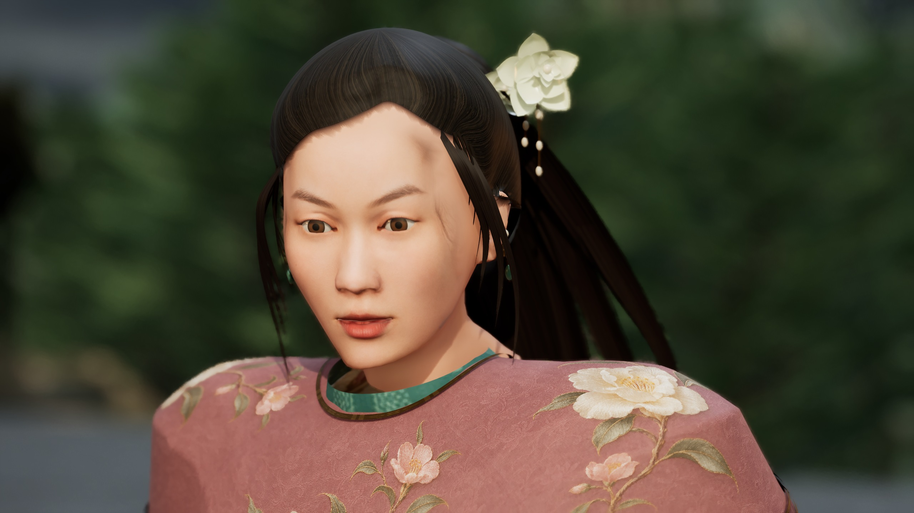

# 海棠女侠

她穿藕荷色折枝花云肩、月白骑装和青绿褶裙，低髻一侧簪白玉花，耳下垂着金丝花扣和小玉坠。面部、眼球、睫毛、头发和衣料都装在实际玩家角色上。以下画面来自 RTX 5080 上运行的 Unreal Engine 5.8.4 独立游戏窗口，原始分辨率为 2560 × 1440。

[同机位对比，左为玉兰、右为海棠](comparison.jpg) · [旧版完整画面](../yulan-wayfarer/courtyard.jpg) · [新版完整画面](courtyard.jpg) · [檐下侧脸](eaves.jpg)

| 面部 | 持剑和移动 |
| --- | --- |
| [正面](portrait.jpg) | [全身](profile.jpg) |
| [闭眼](blink.jpg) | [战斗背面](rear.jpg) |
| [侧前方](front.jpg) | [行走](walk.jpg) |

眼球的角膜反光随视角移动，皮肤和上睫毛共享眨眼动作。她目前保持静止的视线和嘴部表情。[角色素材、生成提示和重建方法](../../../native/Art/Wayfarer/) · [运行游戏](../../../native/README.md)

## 三场实战

自动输入驱动同一名女侠走完全程，从起点计时，她在 22.20 秒击败守钟人、59.89 秒击败披纱鹭、98.92 秒击败灰烬圣徒。录像剪取三段交手，声音来自同一次运行的引擎立体声混音。窗口录像按固定帧率采集，重复帧不用于评估游戏流畅度。

[27 秒实战录像](three-courts.mp4) · [守钟人](Bellwarden.jpg) · [披纱鹭](VeiledHeron.jpg) · [灰烬圣徒](CinderSaint.jpg) · [角色、位置、血量与胜利记录](three-courts.json)

## 帧时间

另一次关闭录像的 1440p 通关使用 Unreal CSV Profiler，帧率上限为 60。在 6,022 帧里，中位帧时间为 16.70 毫秒，P95 为 19.34 毫秒，P99 为 22.08 毫秒，18 帧超过 33.33 毫秒。首帧耗时 261.44 毫秒，途中第 70.91 秒有一帧耗时 136.39 毫秒。第一次单独测帧时，自动操作在披纱鹭剩 1 点血后持续未命中，随即重启测量。这里的统计取自重跑通关的整趟数据。[逐帧记录](frame-times.csv)
