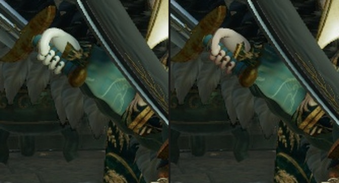
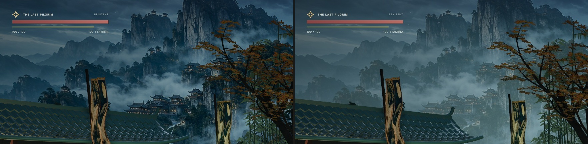
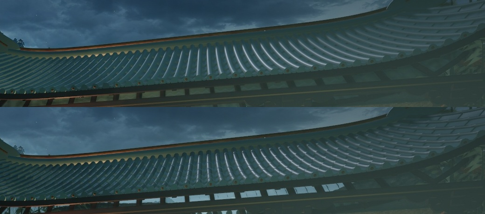

# Hands, roof tiles and the distant valley

[The Bellwarden](belfry.jpg) · [The Veiled Heron](heron.jpg) · [Saint of Cinders](cinders.jpg)

These 2560 × 1440 Chrome screenshots were captured inside the production game. The capture driver started each encounter from the selection screen, approached the combatant and strafed. Each version used the same inputs and frame steps. The hand and porch changes appear in the Heron arena. The distant valley haze uses a different colour in each of the three arenas.

The grip crop is enlarged twofold. The Heron's skin now has warm pressure pads, folds and tapered fingers. The thumb uses the same varying cross-section as the other fingers. Bias-wrapped silk gathers at the cuff. The two hands and sabres were also baked to the animated exchange model.

The aerial colour increases towards the foot of the distant mountains. The courtyard buildings and actors remain in front of that layer.

Each curved run on the moon-gate porch uses six overlapping sections with raised lips. Firing colour varies between pieces. The crop shows how the porch catches light from the combat camera. The revised geometry and vertex colours are present in the updated exchange model.
