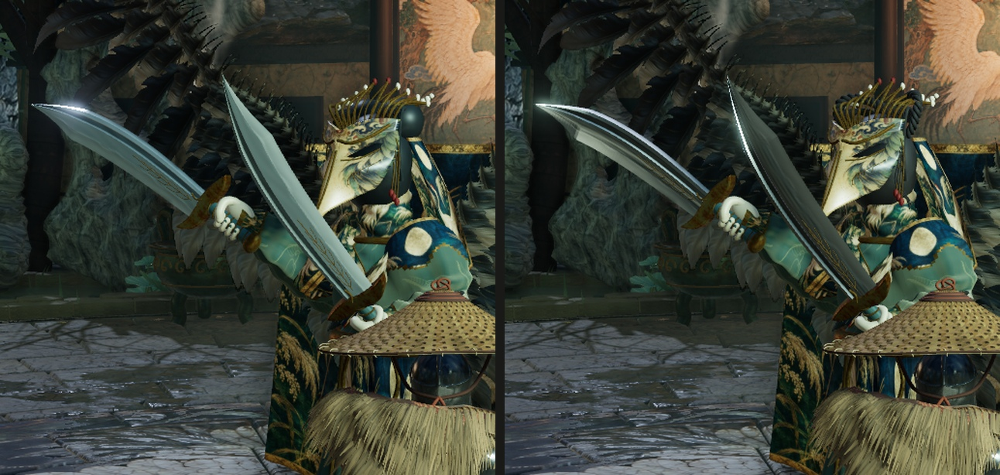

# The Heron's braided hair and honed sabres

The left frame uses the painted headpiece from revision `75284dc`. The right frame uses the coiled hair and ground steel in this revision. The camera, 2560 × 1440 canvas, input sequence and crop are shared. The silk collar, porcelain mask and wing paint carry over from the previous pass. [Full frame](guard.jpg)

Each side of the head now has three interwoven locks around an open centre. The steel has a convex face between the fuller and the edge. The court lighting reflects along that face as the actor rotates the sword. This changes the view-dependent highlight and leaves the combat clock and wrist trajectories intact.

[Close combat](combat.mp4) shows movement, attack and dodge inputs in the playable browser encounter. The silent 3.5-second clip contains 105 frames from the centre of the 1440p Mac Chrome viewport. The capture driver advanced the simulation two 60 Hz ticks per frame. This clip documents the rendered action, not real-time frame pacing. [Three real-time Windows encounters](clears.json)
