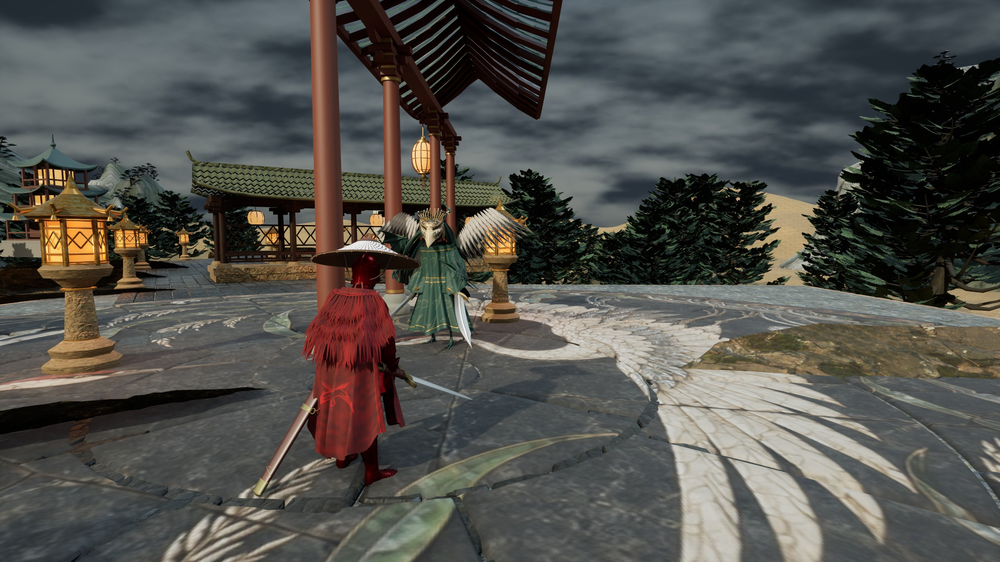

# The Veiled Heron

The second native boss waits at the moon gate. Her porcelain bridal mask, crown and paired sabres follow the head and hand bones of the combat skeleton. Her pleated damask coat follows the hips and thighs. Layered cutout feathers form the wings above her shoulders. Her opening fan sends seven physical meshes down separate paths. At closer range she commits to a straight lunge, then cuts with her sabres. A short synthesized blade-and-silk cue accompanies each windup.

[The fan in flight](feathers.jpg) · [Crossed sabres in melee](sabres.jpg) · [Continuous game-window recording](veiled-heron.mp4)

The three images are full-frame 2560 × 1440 Unreal screenshots on a Windows RTX 5080. The standalone editor game uses the same player, encounter AI, materials and route as the launcher. For repeatability the optional `native/Scripts/probe_heron.py` places the possessed player at the entrance of the second court. The victory trial sends combat inputs and follows the target with the camera. The defeat trial leaves the player exposed.

| 1440p trial | Observed outcome |
| --- | --- |
| [Attack and evade](victory.json) | The first defeated sample was at 20.84 seconds, with 10 HP left on the player. The trace records all three attacks and seven feathers in flight. |
| [Take the hits](defeat.json) | Player HP fell below zero, the map reloaded, and a newly possessed player had 10 HP back at the route entrance. |

The 954 sampled combat tick intervals had a median of 16.74 ms and a 95th percentile of 18.94 ms under a 60 FPS cap. The intervals include synchronous screenshot readbacks. The video is a separate 1280 × 720 window capture with its original timing and no audio.
