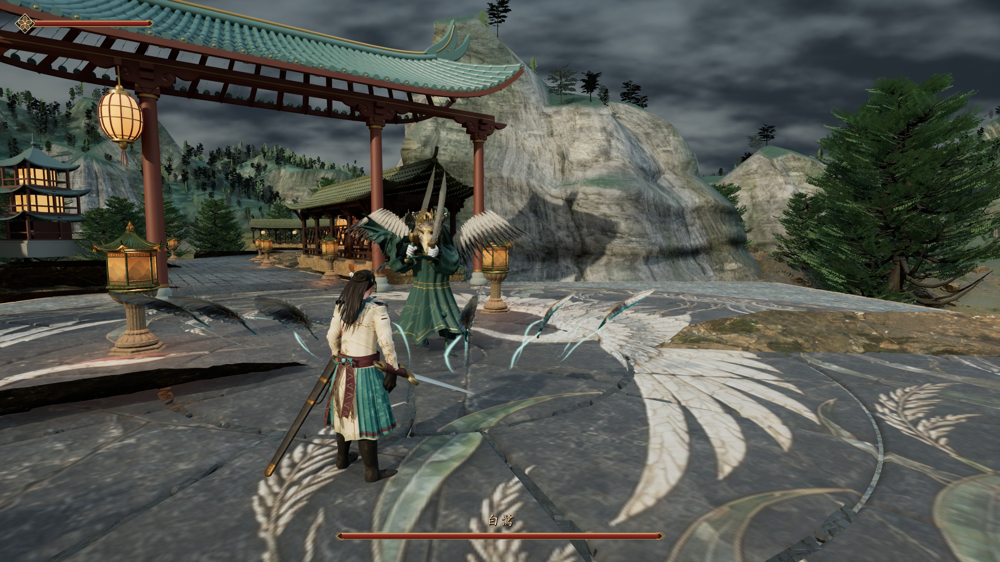

# 披纱鹭 · 七羽齐射

在月门庭院，披纱鹭用左手托起七枚飞羽；收拢的羽梗在出手前张成一把扇。飞羽离手后沿锁定的七条射线向外分开，珠白羽面、深青羽缘和金色中轴各自受光。羽梢后有两股弯曲的气流，收在手中时不可见。蓄力的刀绢声之后，是独立的振羽与金饰轻响。

[3.8 秒原速实战节选，含游戏进程的声音](flight-and-step.mp4) · [闪身输入与血量记录](evade.json)

影片来自同一次独立窗口运行。自动输入在飞羽走过 4.35 米时触发海棠已有的侧向闪身，结束时仍有 10 点血。片段保留游戏速度，用最后一帧引擎截图对照窗口录像，并按 Windows 游戏进程的声音数据包交付时间拼接其输出。没有采集麦克风或其他应用。此次录制的放羽声比逻辑释放时刻晚约 0.39 秒，蓄力声晚约 0.59 秒；这些数值包含录制路径的延迟，尚不能单独证明本机扬声器的时序。[使用的 Windows 进程回环工具](https://github.com/tsubome/ProcessAudioCapture)

## 同机位实拍

两次测试均在 RTX 5080 上以 2560 × 1440 运行 Unreal Engine 5.8.4。拍摄点位于同一段月门地雕，保留普通跟随镜头和 HUD。脚本将海棠放在中线，等 Boss 自行完成第一次齐射，按状态与实际飞行距离触发截图；两次截取的距离会有一帧左右的差别。

| 动作 | 改前 | 改后 |
| --- | --- | --- |
| 开始蓄力 | [蓄力](before-opening.jpg) | [起扇](after-opening.jpg) |
| 即将离手 | [出手前](before-opened.jpg) | [展扇](after-opened.jpg) |
| 飞出约 0.9 米 | [旧飞羽](before-release.jpg) | [离手](after-release.jpg) |
| 飞出约 2.8 米 | [旧齐射](before-spread.jpg) | [七线展开](after-spread.jpg) |
| 飞出约 5 米 | [旧来羽](before-passing.jpg) | [近身飞羽](after-passing.jpg) |

两次中线站立测试都记录到七枚活动飞羽，海棠都从 10 点血降到 8 点。投射物的移动速度、角间距和扫掠判定沿用既有设计。[旧版记录](before-cast.json) · [新版记录](after-cast.json)

[飞羽网格的可重建源文件](../../../art/bake_flight_quill.py)使用项目原有的[羽面贴图](../../../public/art/heron-quill.png)。网格沿贴图的透明边界拟合羽面与弧度，羽缘、分叉羽枝、中轴和气流均有独立几何形状。从仓库根目录运行 `python art/bake_flight_quill.py` 即可重新烘焙，依赖 Pillow。已生成过月门庭院的工程启动时也会重新装配七枚飞羽。

和《Bloodborne》的官方对峙画面相比，月门地雕与后方山石的明暗仍接近。飞羽路径变清楚后，远崖上等间距的松树也依然显眼。[PlayStation 官方对峙画面](https://blog.playstation.com/2014/11/20/new-bloodborne-weapon-and-hunter-emerge/)

## 三庭回归与帧时间

两次均为普通跟随镜头、2560 × 1440、60 帧上限的独立窗口运行。关闭录屏和截屏后，自动输入沿同一条山路依次打通了守钟人、披纱鹭和灰烬圣徒。

| 运行 | 帧数 | 中位帧时间 | P95 | P99 | 超过 33.33 毫秒 | 最长一帧 |
| --- | ---: | ---: | ---: | ---: | ---: | ---: |
| 第一趟 | 4,983 | 17.24 ms | 34.09 ms | 60.26 ms | 260 | 459.12 ms |
| 重跑 | 5,760 | 16.75 ms | 19.06 ms | 21.66 ms | 18 | 220.66 ms |

第一趟在到达披纱鹭之前已出现长帧，重跑波动较小。两趟均有卡顿，仅凭这些记录不能把差异归因于飞羽。[第一趟战斗](three-courts.json) · [第一趟逐帧数据](frame-times.csv) · [重跑战斗](repeat-courts.json) · [重跑逐帧数据](repeat-frames.csv)
