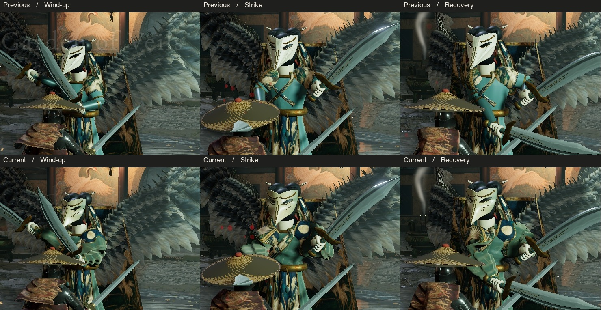

# The Veiled Heron's cross-collar jacket

Three frames of *Silken crescent* show how the jacket changes shape as the sabres cross. The top row is revision `01d6551`. The bottom row is `c3835ae`. Both were played through the regular encounter menu on Penitent in Chrome on an Apple M1 Max at 1920 × 1080. The capture driver repeated the approach and advanced the game at the same 60 Hz intervals. The attack reduced player health from 100 to 79 on frame 48 in both runs.

[Full wind-up](gather.jpg) · [Strike](strike.jpg) · [Recovery](recovery.jpg) · [Attack timing](stroke.json)

The sleeves share the two arm bones used by the sword poses. Their cut opens below the elbow and tapers to a patterned cuff. A shorter inner collar slips behind the wider outer facing, above a jacket pulled diagonally across the waist. A woven cloud-and-feather repeat covers the silk. The hand follows the hilt, with tapered finger joints and lacquer nail plates. The glazed cheeks rise below the eye openings and carry fine feather-shaped wires. The sleeve creases follow the rig. They do not simulate loose cloth colliding with the torso. The neck and hair still look simple at this distance.

[Real-time garden exchange with stereo game audio](garden.mp4) · [Hit confirmation](hit.json)

[Complete garden fight with sound](duel.mp4) · [Recorded result](duel.json)

The complete recording runs for 28.5 seconds. The Heron awakens, the player makes five parries and the fight ends at the victory screen.

The shorter movie is a 5.5-second exchange on Pilgrim. It was captured independently of the fixed-step stills. The saved chapter playthrough and retry results cover all three encounters.

[Three clears](clears.json) · [Three defeat and retry checks](retries.json) · [CI for the game build](https://github.com/lzongren/vesper-hollow-tide/actions/runs/43597396966)
