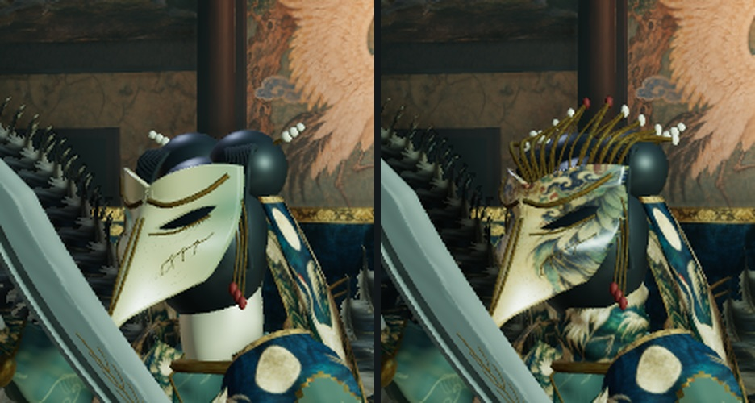
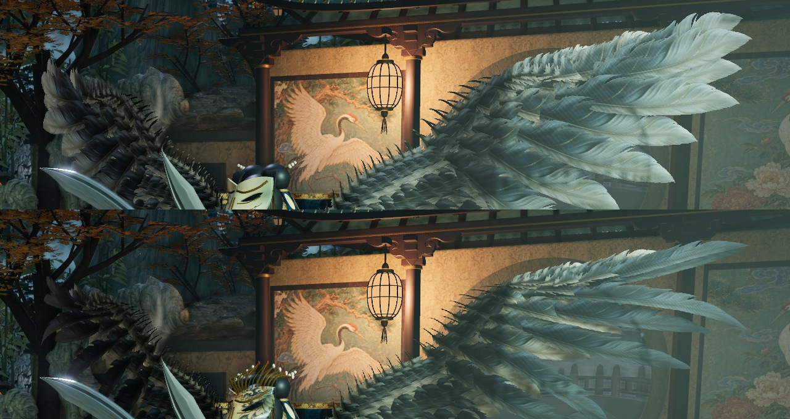

# The Veiled Heron in combat

[Full combat view](full.jpg) · [After the attack input](attack.jpg) · [During the dodge sequence](evade.jpg)

The images come from the production browser game at 2560 × 1440 on the same Mac in Chrome. The capture driver selected the Heron from the menu and used the same forward movement, strafe, strike and dodge inputs in both versions. It advanced the animation callbacks at fixed simulation intervals. The sequence is a visual check, not a real-time frame-rate measurement.

The face crops cover the same 232 × 250 pixels from each frame and are enlarged twofold. The new forehead and cheek shapes carry a continuous painted glaze. The gold crest and pearl pins cast shadows with the head. A folded silk throat piece joins the mask to the robe.

These are native-size crops of the two production frames. The long outer feathers now taper into individually twisted, slate-tipped primaries. The texture still repeats across neighbouring feathers. The two sword blades and the character's underlying rig are common to both captures.

The same release cleared all three awakened encounters in a real-time Windows run on an RTX 5080, on Pilgrim difficulty. All 83 served files matched the Mac production build by SHA-256. [Windows outcomes and frame intervals](clears.json)
