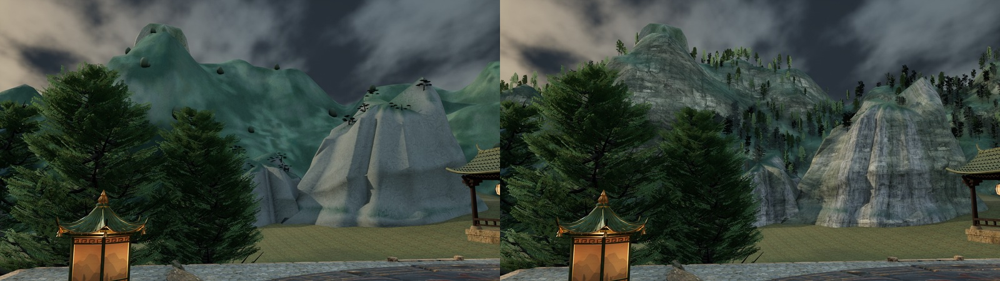

# 兴坪山林

这是相同镜头、相同场景光照下的两次 Unreal 实机截图，分辨率均为 2560 × 1440。旧版铜狮旁的山坡上散着黑点。只在诊断镜头里隐藏旧树冠后，黑点随之消失。新版远山使用四种松杉外形，树根按每个地形三角面的实际高度落地。缓坡成林，较陡的岩面留出裸石。灰烬祠周围的八座近峰有单独的岩纹和崖顶树。

| 机位 | 上一版 | 这一版 |
| --- | --- | --- |
| 铜狮旁望向镇潮殿 | [旧树冠](before-gate.jpg) · [隐藏旧树冠](before-without-groves.jpg) | [山坡林带](after-gate.jpg) |
| 山道上的角色与灯亭 | [旧山道](before-road.jpg) | [玉兰女侠与新林线](after-road.jpg) |
| 灰烬祠外的石峰 | [旧岩面](before-ridge.jpg) | [岩台与松杉](after-ridge.jpg) |

远景共种植 37,895 株，祠堂岩台另有 105 株。每株使用同一棵源模型两个方向的树影，在地形上占四个三角形。枝叶和针簇来自松杉模型，远处通过覆盖率修正保持树形。近岩沿用原模型的雨痕，再混合三向投射的层状石材纹理。祠前的空地和背景山体的大轮廓仍能看出简化。

[美术来源与重建方法](../../../native/Art/RiverPeaks/) · [实机机位](../../../native/Scripts/probe_canopy.py) · [启动游戏](../../../native/README.md)

## 三庭实战

玉兰女侠沿山道从钟殿走到灰烬祠，在同一趟运行中击败三个 Boss。守钟人、披纱鹭和灰烬圣徒分别在游戏时间第 24.39、60.62 和 98.09 秒倒下。录像剪出入庭与三场交手，声音来自同一趟运行的 48 kHz 立体声混音。窗口录制在结束写入时退出，已用各庭实机截图定位并核对三个片段。

[三庭实机片段](three-courts.mp4) · [钟殿](Bellwarden.jpg) · [月门](VeiledHeron.jpg) · [灰烬祠](CinderSaint.jpg) · [行进与交手记录](three-courts.json)

关闭录制后，第二趟同样打通三庭。RTX 5080 在 2560 × 1440、60 FPS 上限下采集了 5,773 帧。帧时间中位数为 16.69 ms，P95 为 18.84 ms，P99 为 21.04 ms。18 帧超过 33.33 ms。首帧为 389.92 ms，开跑 30.52 秒处另有 188.05 ms 的停顿。GPU 时间中位数为 5.27 ms。[逐帧数据](frame-times.csv)
