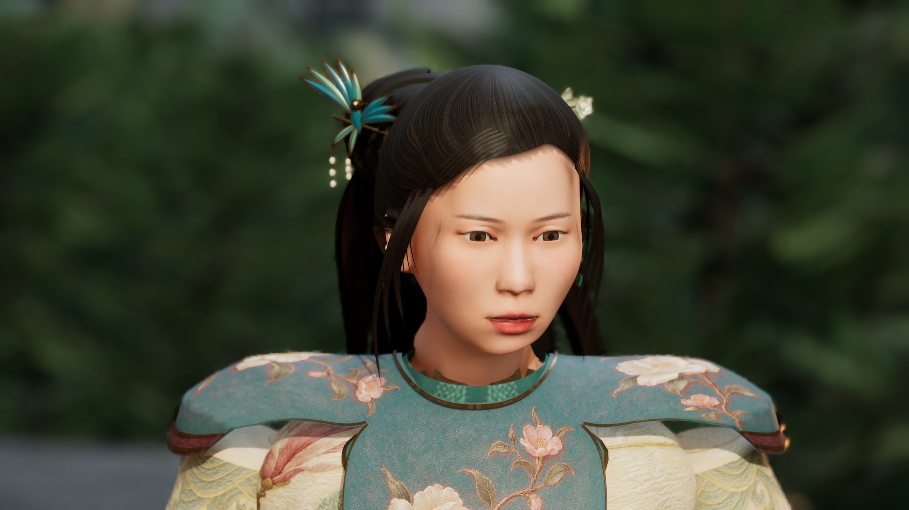

# 玉燕海棠

海棠是山道上由玩家操控的女剑客。她穿象牙色交领骑装与青裙，湖青云肩在肩头分成四瓣，领缘露出底下的绣衣。低髻一侧是掐金丝、嵌蓝绿釉的玉燕簪，另一侧只留一小枝白玉花。簪尾的珍珠与额前分梳的发丝在转身时仍看得见。

[正面近景](front.jpg) · [侧面](profile.jpg) · [后侧发髻与云肩](reverse.jpg) · [持剑全身](dress.jpg) · [上一版的实机近景](../wayfarer-gaze/neutral.jpg)

这五张图来自 Windows 上 Unreal Engine 5.8.4 的独立游戏窗口。拍摄脚本将镜头移到角色身前和身后，使用山门原有的光照、角色自身的材质与空闲动画。脸颊、下颌、眉弓和唇缘沿原骨骼网格调整，眼睑和睫毛仍共享眨眼变形。[角色装配脚本](../../../native/Scripts/fit_wayfarer.py) · [可复拍的镜位](../../../native/Scripts/probe_plum_portrait.py)

## 第三人称战斗

[带游戏原声的三场交手](three-courts.mp4) · [进入雨廊](approach.jpg) · [守钟人](Bellwarden.jpg) · [披纱鹭](VeiledHeron.jpg) · [灰烬圣徒](CinderSaint.jpg)

战斗录像使用游戏跟随镜头和 HUD。自动输入驱动同一个角色沿山道走过三个庭院，交手片段保留同期引擎混音。雨廊改造前后的同机位比较另见[守钟人庭院](../bell-gallery/)。

录像这趟，玩家模型为 `YuyanHaitang`，三次胜利分别发生在出发后 25.00、63.52 和 101.79 秒。第一次试走时直线输入顶在照壁上；改走廊下中央开口后完成全程。三个交手片段分别用该次游戏独立截图匹配窗口录像，再对齐 48 kHz 立体声混音。节选共 30 秒。[本次角色、血量、胜利和移动记录](recorded-courts.json)

## 关闭录屏后的实测

同一台 RTX 5080 在 2560 × 1440、60 帧上限下再次走通三庭。守钟人、披纱鹭、灰烬圣徒分别在 22.15、60.46、98.21 秒被击败。Unreal CSV Profiler 记录了 5,630 帧，帧时间中位数 16.75 毫秒，P95 为 19.26 毫秒，P99 为 21.93 毫秒。24 帧超过 33.33 毫秒，最慢一帧为 208.36 毫秒。这组数据来自 Windows 独立游戏窗口，仍有偶发卡顿。[通关记录](three-courts.json) · [逐帧时间](frame-times.csv)
