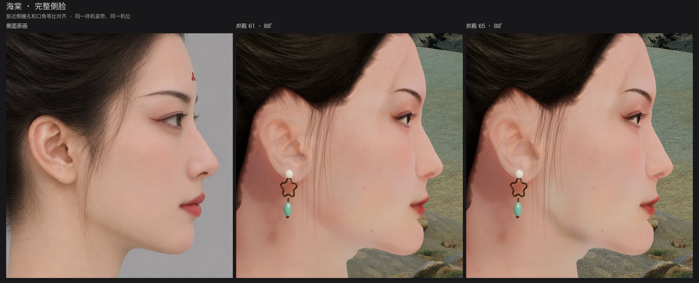
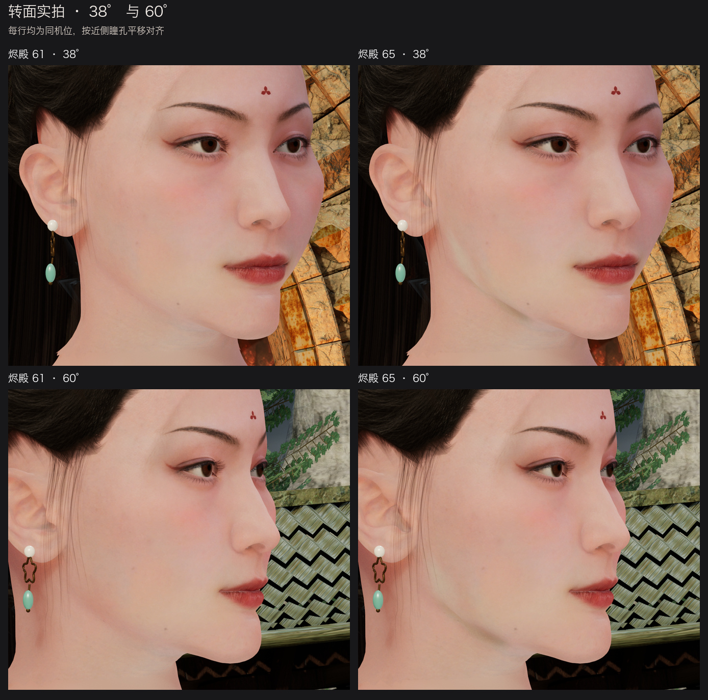
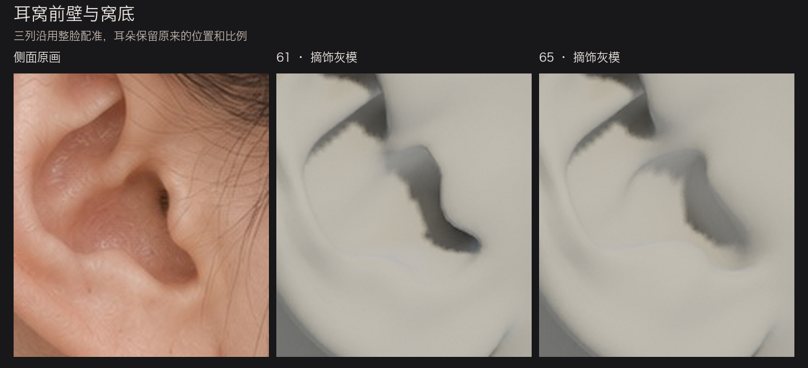

# 海棠的颊下弧线与耳窝前壁

[烬殿整脸同步转面 · 12 秒](face-orbit.mp4)　｜　[耳窝、下颊和颏尖的近景转面 · 12 秒](ear-orbit.mp4)

第 61 版的正面下颊已经较窄，转到斜侧面时，耳前到下颌的软组织仍显得厚。这轮沿原画收窄耳前到口角下方的软组织，同时在双侧皮肤材质上淡化了下颊偏红的区域。对比图用近侧瞳孔与口角作等比对齐。影片左侧是第 61 版，右侧是新版。两版使用同一烬殿镜头、相同待机姿势和表情时序。

38° 转面时，靠近口角的下颊轮廓向内收了约 5–8 个实机像素。88° 侧面按近侧瞳孔和口角与原画配准，在下颊四个位置测量明暗下降最快的地方，新版与原画相差 5、1、1、1 像素。耳前最靠后的那段仍比画面偏亮，60° 暖光下靠近颏部的暗部也略偏橄榄灰。

[转折位置与宽度](cheek-ridge.jpg) · [下颌近照](jaw.jpg) · [90° 完整侧影](head.jpg)

第 61 版的耳甲前壁悬在耳窝上方。新版将这段软骨向外展开，沿相邻网格把耳屏与耳甲底之间的弯折修圆。下图用烬殿的灰色材质显示同一机位，去掉了耳饰与头发。原画使用自身光照。

第 61 版耳窝下缘有一道突然中断的硬折。新版沿耳屏往里逐渐卷进耳窝，耳窝下段也更容易看清。实机里窝底仍比原画浅，原画耳屏尖更短、更圆。

[整耳灰模](ear-clay.jpg) · [带饰近照](ear.jpg)

两段转面由两版各 360 张原生 Unreal 游戏视口画面配成。镜头从 −12° 转到 116°，再回到起点。影片按每秒 30 帧播放。角色在两版中使用相同待机动作，游戏中的火光独立变化。

[轮廓与灰模测量](measurements.json) · [颊下整段明暗读数](cheek-field.json) · [导出网格的颊面截面](cheek-mesh.json) · [耳甲壁截面](ear-mesh.json) · [耳窝深度与肤色对照](ear-review.json) · [同机位镜头坐标](cameras.json) · [转面核验](recording.json) · [三场首领战验证](game-check.json) · [第 58 与 61 版对照](../cheek-and-ear/)

在 Windows 项目下运行 `Scripts\play_pilgrimage.ps1 -CheekStudy -HeadStudy -Turntable` 可在烬殿查看当前的可玩模型。
