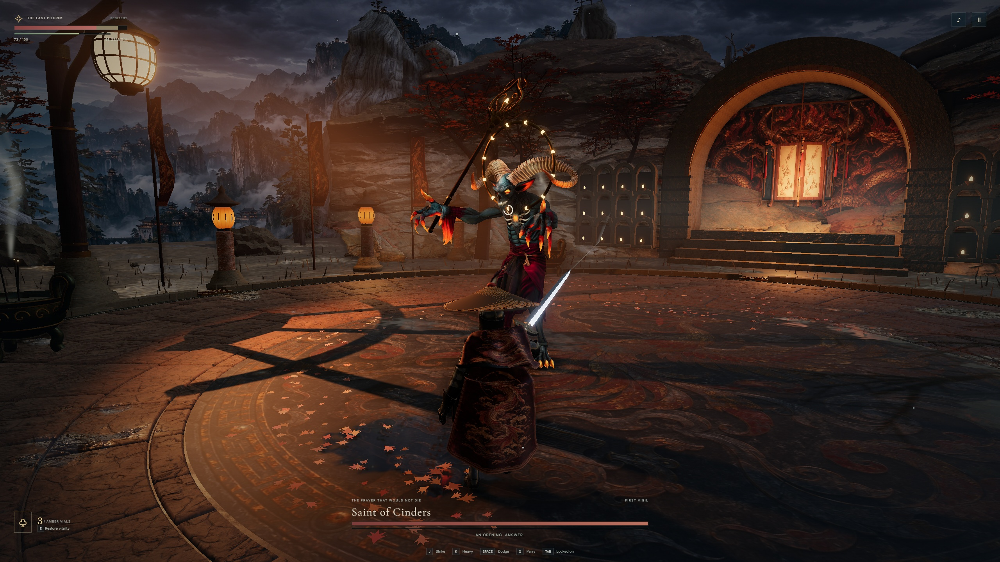

# The pilgrim's jian in the Ashen Reliquary

[Light and heavy cuts in the previous and current builds](comparison.jpg) · [Fixed-camera trail comparison](matched-trail.jpg) · [Complete shrine fight with stereo audio](shrine.mp4)

The player now carries a straight double-edged sword with a cast bronze guard, a pierced pommel and cord crossed over the grip. Four long planes and a narrow ground edge carry the light from the shrine lamp. Seven brass dots sit near the forte. The hand socket is the origin and the tip is 1.43 metres above it. [Raised guard](raised.jpg) · [Weapon model in glTF](../../../native/Art/PilgrimJian.glb)

The earlier trail filled the space swept by most of the blade. Now a moving highlight follows a 10.5 cm section just behind the tip and fades across its width and over the last 50 ms. The visible mark grows with point speed. Its history resets across different actions and gaps longer than the exposure. The fixed-camera sheet shows the trail study before the camera adjustment and final steel-roughness change. The other sheet compares the previous release with the finished build. [Light cut](light.jpg) · [Crossing the body](cross-cut.jpg) · [Follow-through](follow-through.jpg)

At close lock-on distance the camera moves toward the sword shoulder, gains a little height and aims farther between the two fighters. At 5.8 metres and beyond it returns to the earlier track. The hat can still hide the hand during parts of a cross-body cut.

## Gameplay captures

Windows Edge ran the production build on an RTX 5080 at 2560 × 1440. For each comparison, the player entered the shrine on Penitent, took the same steps left, forward and right and then pressed J or K. Shots use 60 simulation steps per second. The comparison shows steps 8 and 11 after J and 26 after K. Full frames retain the combat HUD. Both sides of each sheet use the same crop and scaling.

The web suite includes a new test for tip placement, fade direction and held, interrupted or discontinuous strokes across 30, 60 and 120 Hz. All 38 web tests and eight native source-tool tests passed. Arm64 Chrome on an M1 Max ran the same light and heavy poses and entered all three courts. [Three playable courts](three-courts.jpg) · [Mac readback](mac.json) · [CI for the gameplay build](https://github.com/lzongren/vesper-hollow-tide/actions/runs/43592024602)

On an Apple M1 Max, arm64 Chrome cleared the awakened Saint of Cinders on Pilgrim in 40 seconds at a 1920 × 1080 viewport, with four parries and five hits taken. The combat callback interval reached 16.8 ms at p95 and 83.3 ms at its longest. Across 2,406 GPU queries the median measured GPU time was 20.76 ms and p95 was 25.76 ms. These GPU measurements cover rendering work and the callback intervals measure browser scheduling. [Mac fight and GPU measurements](arm-shrine.json) · [Mac result screen](arm-result.jpg)

The downloadable web build contains the HTML, JavaScript, models, textures and audio. Extract the zip, open a terminal in the folder containing `index.html`, run `python3 -m http.server 8000 --bind 127.0.0.1` and open `http://127.0.0.1:8000/` in a WebGL 2 browser. GitHub requires sign-in for Actions artifacts. [Web build from CI](https://github.com/lzongren/vesper-hollow-tide/actions/runs/43592024602/artifacts/14112269260)

The Windows production bundle and the local build matched all 63 files in the Linux CI artifact by path and SHA-256. A keyboard driver cleared all three awakened encounters on Pilgrim. Separate Penitent runs reached defeat and restored full health on retry. The callback intervals below cover one unrecorded clear per boss. [Victory readbacks](victories.json) · [Defeat readbacks](defeats.json) · [Belfry](belfry.jpg) · [Garden](garden.jpg)

| Encounter | Clear time | Combat callback p95 | Longest interval |
| --- | ---: | ---: | ---: |
| The Bellwarden | 0:26 | 16.9 ms | 1.54 s |
| The Veiled Heron | 0:26 | 16.8 ms | 1.54 s |
| Saint of Cinders | 0:36 | 16.8 ms | 1.59 s |

A separate shrine clear captured 1229 compositor frames over 89.29 seconds, with a final 1.25-second hold. It uses a 1600 × 900 video stream and 48 kHz stereo audio from the game. The final decoded frame shows the victory overlay with a 42-second game clock, four parries and three hits taken. Compositor capture averaged 13.8 frames per second. A separate screenshot preserves the result at full resolution. [Watch the fight](shrine.mp4) · [Result](result.jpg)
