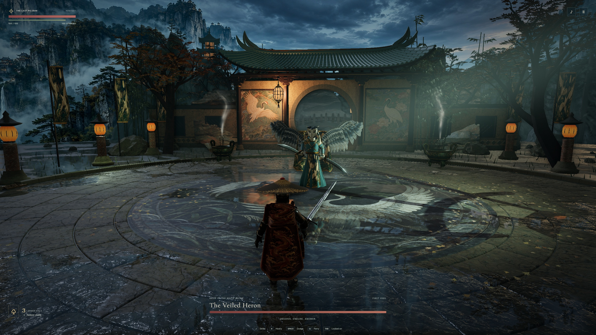

# Mountains beyond the court

[Three encounter comparisons](comparison.jpg) · [The beacon at full pixel scale](beacon-detail.jpg) · [Complete garden fight with stereo audio](garden.mp4)

At the garden entrance, the warm windows of the western beacon break the dark line of branches above the moon gate. As the pilgrim circles the Heron, the pavilion passes behind the nearer roof. The bridge and its opening remain visible. [Entrance](garden.jpg) · [Camera sequence](moving-camera.jpg) · [After moving left](garden-crossing.jpg) · [Returning into combat](garden-combat.jpg)

Each court has eight three-dimensional limestone spurs, with different heights and gaps. The belfry corridor breaks the sightline toward one group. Another rises above the outer wall of the ash sanctuary. Exposed summits have wind-trained pines with separate clusters of needles. Mist collects near the bases. Beyond these ridges the most distant valley and sky still share the earlier panorama. [Belfry](belfry.jpg) · [Reliquary](shrine.jpg)

The garden arrangement has 32,832 triangles of rock, 55,264 of pines and 2,676 for the beacon. One mirrored texture provides the limestone color and bump detail. The extra image transfer is 831 KiB. The native GLB embeds the color texture and retains the three-storey beacon in position. Import and lighting inside Unreal are pending. [Garden GLB](../../../native/Art/GardenRidges.glb) · [Standalone beacon](../../../native/Art/MountainPassBeacon.glb) · [Texture and generation prompt](../../ASSETS.md)

## Gameplay checks

The comparison uses the previous and current production builds on the same RTX 5080 in Windows Edge at 2560 × 1440. Each row repeats the same inputs, camera and simulation steps. Stills keep the game HUD. Both sides use the same crop. There is no additional color grading.

The production bundle on Windows matched the local build and the Linux CI artifact across all 63 files by path and SHA-256. The web suite ran 37 tests, and the native source-tool suite ran eight. The M1 Max check entered all three courts at 1440 × 900, moved, struck, paused and returned to selection. A second garden run captured lateral movement at 1920 × 1080 in arm64 Chrome. [CI for gameplay revision 5d6693f](https://github.com/lzongren/vesper-hollow-tide/actions/runs/43590605572) · [Apple Silicon results](mac.json)

The keyboard driver cleared all three awakened encounters on Pilgrim. Separate Penitent runs reached defeat and restored full health on retry. These frame intervals cover the combat portion of one unrecorded clear per boss. [Victories and timings](victories.json) · [Defeats](defeats.json)

| Encounter | Time shown on HUD | Callback p95 | Longest combat interval |
| --- | ---: | ---: | ---: |
| The Bellwarden | 0:27 | 16.9 ms | 2.31 s |
| The Veiled Heron | 0:26 | 16.8 ms | 1.17 s |
| Saint of Cinders | 0:43 | 16.8 ms | 2.51 s |

The garden film follows a separate clear from entry to the final knockdown. It preserves 815 timestamped frames over 54.64 seconds with the game’s stereo audio at 48 kHz. The encoder holds the final combat frame for 1.25 seconds. A separate screenshot from the same run shows five parries, zero hits taken and a clear time of 0:27. [Victory overlay](result.jpg) The capture used a 1600 × 900 viewport. [Fight recording](garden.mp4)

A separate instrumented garden clear measured GPU draw time with asynchronous WebGL timer queries and recorded long animation frames. The median GPU interval across 1,565 resolved samples was 4.80 ms, and the 95th percentile was 6.28 ms, with zero disjoint events. [GPU and long-frame trace](profile.json)
