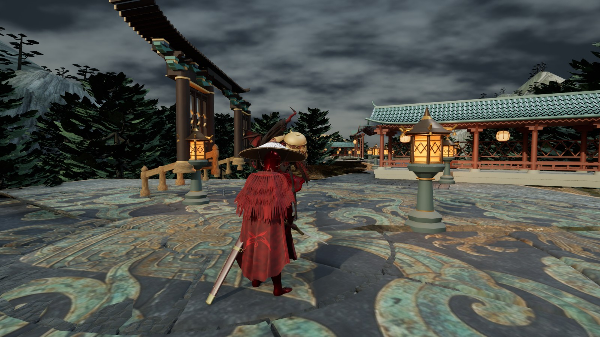
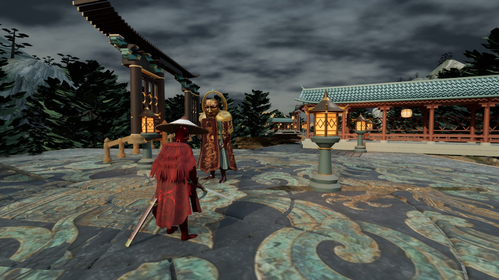
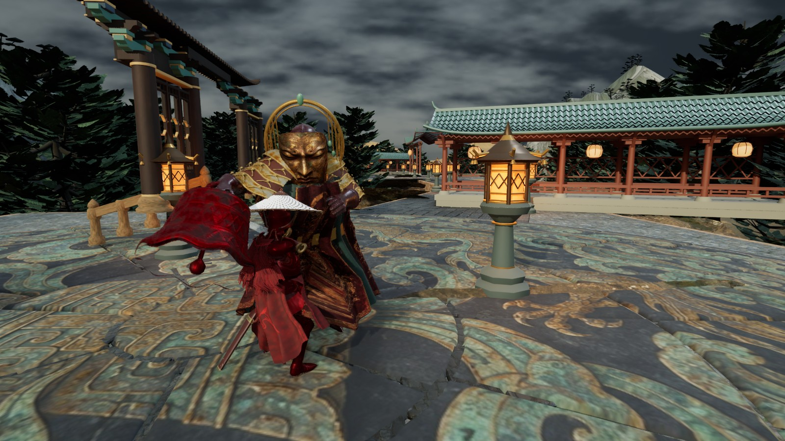

# Bellwarden at combat distance

Windows standalone Unreal Editor 5.8.4, RTX 5080, 1600 × 900. The before and after frames start with the same player position and control rotation in the first court. The shoulder offset increases from 40 to 118 cm and the spring arm from 400 to 420 cm. All three images are full viewport captures converted to JPEG.

| Previous approach | Revised approach |
| --- | --- |
|  |  |

The face uses the game's repousse mask artwork on a curved mesh with a raised brow, nose and cheeks. A two-ring aureole and eight stone drops follow the head. Four dragon damask panels lie over a pleated inner garment. Their upper ends follow the spine, and their lower ends transfer weight to the pelvis and thighs. The bronze shoulder castings use the game's metal color and normal maps.

The [sampled duel](duel.json) uses the normal combat code, with enhanced-input mouse strikes and the player's evasive step driven by the fixture. At 18.70 seconds the keeper reached zero HP and the pilgrim retained 10 HP. This records one automated exchange. The garden and shrine fights are currently playable in the browser version.
