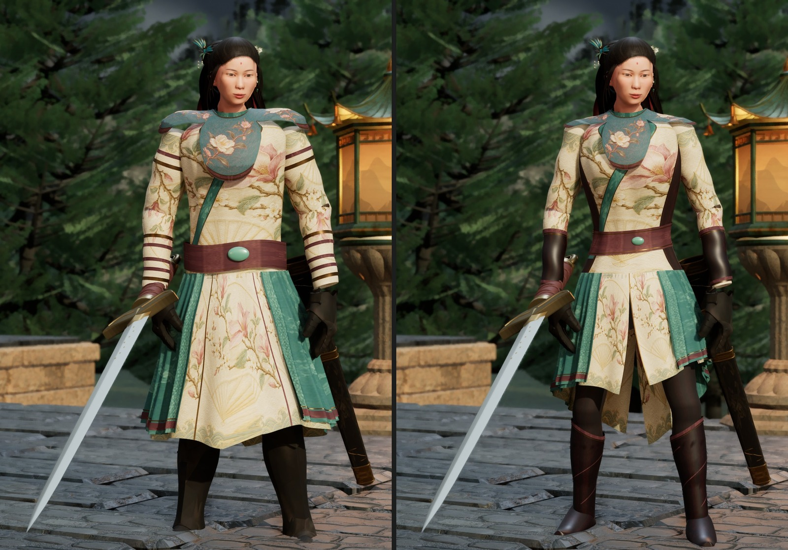

# 海棠的骑装与身形

两列均来自 2560 × 1440 的 Unreal 游戏窗口，在山路同一点、同一天光下拍摄。相机离角色 4.78 米，水平视角 39°，并排图对两幅原图作相同裁切。站姿由原有战斗骨架驱动。

| 角度 | 改前 | 改后 |
| --- | --- | --- |
| 正面偏转 18° | [全图](before-front.jpg) | [全图](after-front.jpg) |
| 侧面 83° | [全图](before-side.jpg) | [全图](after-side.jpg) |
| 背面偏转 161° | [全图](before-back.jpg) | [全图](after-back.jpg) |

收低云肩的外缘，让肩、袖山和上臂连成一线。上衣两侧拼深青色丝料，腰封顺着腰线收拢。腰封高度处，静止模型的上衣横宽从约 31.6 厘米收至 26 厘米。髋部有连续的裤腰衬层，前襟分片，持剑侧的下摆较短，背侧保留衣长。

膝、胫、小腿后侧和踝部分别塑形。靴筒沿小腿收窄，鞋头微抬，鞋跟和前掌分别跟随脚与趾关节。实战沿用原骨架与攻击判定。现有待机姿势仍然双脚分立，衣摆的变形由骨骼权重和材质驱动。

[服装网格](../../../native/Scripts/wayfarer_outfit.py) · [裤腿与靴型](../../../native/Scripts/wayfarer_legs.py) · [复拍镜位](../../../native/Scripts/probe_plum_portrait.py)

## 穿这身骑装交手

[守钟人交手录像，11.5 秒，含游戏声音](bell-duel.mp4) · [接敌](approach.jpg) · [守钟人](Bellwarden.jpg) · [披纱鹭](VeiledHeron.jpg) · [灰烬圣徒](CinderSaint.jpg) · [三庭输入试走记录](three-courts.json)

录像截自正常第三人称游戏窗口，录音只捕获该进程的输出。两处带时间标记的游戏截图用于校准画面与声音。静态图是游戏在 2560 × 1440 分辨率下输出的原始视角，录像为 1600 × 900，以 30 fps 输出，窗口采集含重复帧。单独关闭录制后测量的引擎帧耗时见[三庭性能记录](../moon-water/#三庭帧耗时)。
