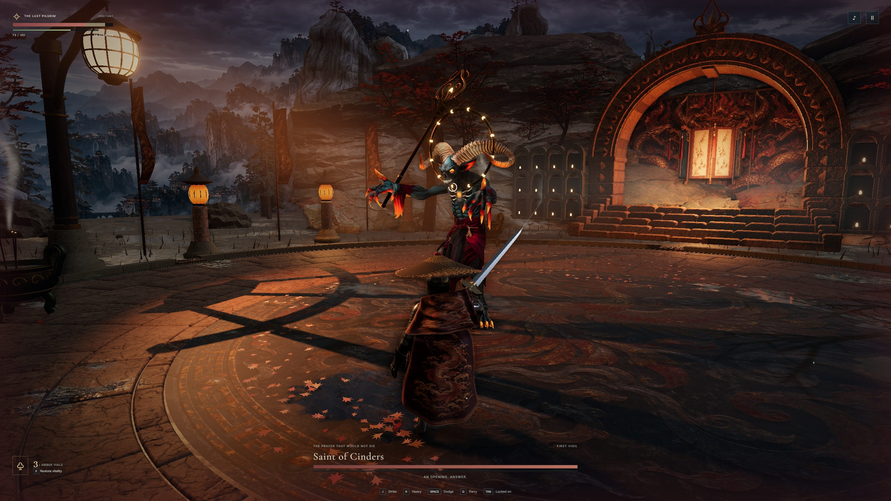

# The lotus arch at the Ashen Reliquary

A ring of 25 carved limestone blocks now carries a row of raised lotus petals. A larger keystone supports an open bronze flame. The blocks vary in depth, and narrow bronze ribs follow the curling stone leaves. The approach has five courses, with staggered joints, chipped corners, low parapets and a worn central tread. Both fighters remain on the court in front of the shrine. [Earlier and current arch](comparison.jpg) · [Opening camera](entry.jpg) · [Native mesh](../../../native/Art/ShrineLotusPortal.glb)

The paired views came from Windows Edge on the RTX 5080 at 2560 × 1440. A keyboard driver selected the third encounter on Penitent, moved left, forward and right, and pressed K. Both images show the same simulation step after that press and use identical crops. The full-size images preserve the HUD and camera framing. The upper tip of the crest reaches the edge of the frame in this heavy-attack pose. The recessed wall behind the lamp still reads as a painted panel.

## Fight on Apple Silicon

Arm64 Chrome on an M1 Max, at a 1920 × 1080 viewport, cleared the awakened Saint on Pilgrim in 40 seconds on the game clock. A separate recorded clear took 53 game seconds with three parries and ten hits taken. The recording includes the HUD, the game's 48 kHz stereo output and the final victory screen. The 1280 × 720 MP4 uses the original times of 1,710 compositor frames over 56.96 seconds and holds the final image for 1.25 seconds. [Complete fight with sound](shrine.mp4) · [Result](result.jpg) · [Separate GPU timing run](arm.json)

The Windows install, the Mac preview and the Linux CI artifact matched by path and SHA-256 across all 63 web files. The distributable is a static WebGL 2 site. Extract the zip and run `python3 -m http.server 8000 --bind 127.0.0.1` in the folder with `index.html`, then visit `http://127.0.0.1:8000/`. [Gameplay build and tests](https://github.com/lzongren/vesper-hollow-tide/actions/runs/43593670908) · [Packaged build](https://github.com/lzongren/vesper-hollow-tide/actions/runs/43593670908/artifacts/14113497073)

From one save slot, the Mac keyboard run cleared the Bellwarden in 27 seconds, the Veiled Heron in 27 seconds and the Saint of Cinders in 44 seconds. Each encounter reached its awakened phase. The third victory displayed the chapter ending. [Three combat results](three-clears.json)

A second Mac run reached zero health on Penitent in each court and retried from the result menu. After each retry, the driver waited for a fresh HUD with 100 / 100 health before advancing. The Windows camera comparison completed. Its separate three-clear run timed out while opening settings and a retry stopped producing results, so the three-clear figures above come from the M1 Max. [Defeat readbacks](retries.json)
