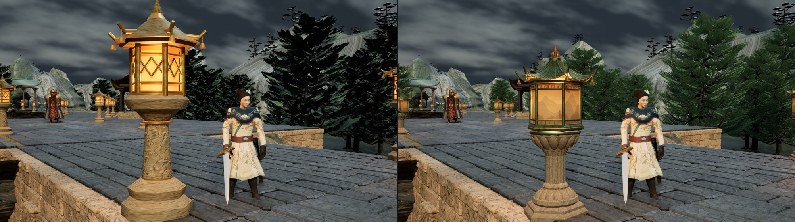

# Lotus lanterns on the mountain road

The native map has 27 six-sided road lanterns. Each has a fluted stone shaft, two courses of carved lotus petals, a curved bronze roof with raised ribs and pendant bells, and a silk screen painted with a continuous ink landscape. Each light sits inside its screen. The [near view](after-casting.jpg) and [road view](after-road.jpg) use the same camera positions, focal lengths and level lighting as the [original near view](before-casting.jpg) and [original road view](before-road.jpg).

The [intermediate road capture](before-foliage.jpg) shows the new lamp under the earlier pine canopy. The two tree meshes now use paired needles on short twigs, an alpha mask that preserves coverage in the distance, and a two-sided foliage material for backlighting. Each screenshot was taken at 2560 × 1440 in standalone Unreal Editor game mode on the RTX 5080.

## Combat and performance

The [continuous gameplay film](route.mp4) follows the playable swordswoman through the three courts. The recording uses only the Unreal game window, with a 1920 × 1080 output and no audio track. The encoder wrote 6,037 frames to a 60 Hz video stream, including 1,080 duplicated frames. The [filmed run](filmed-route.json) records all three victories. The 1440p stills show the normal combat camera and HUD in the [Bellwarden](Bellwarden.jpg), [Veiled Heron](VeiledHeron.jpg) and [Saint of Cinders](CinderSaint.jpg) fights. The [screenshot run](captured-route.json) and [timing run](profiled-route.json) each record three victories.

A separate run with a 60 FPS cap and screen recording disabled collected 5,566 engine CSV samples from player possession to the third victory. Seventy frames exceeded 33.33 ms. GPU time reached 53.29 ms and total frame time reached 143.77 ms. [Per-frame counters](frame-times.csv)

| Engine counter (ms) | Median | P95 | P99 | Maximum |
| --- | ---: | ---: | ---: | ---: |
| Frame | 16.67 | 23.59 | 34.99 | 143.77 |
| Game thread | 2.63 | 9.54 | 19.47 | 116.92 |
| Render thread | 6.40 | 15.25 | 25.70 | 90.94 |
| RHI thread | 2.24 | 5.13 | 9.55 | 23.02 |
| GPU | 4.81 | 5.98 | 6.60 | 53.29 |

[Lantern geometry](../../../native/Scripts/lotus_lantern.py) · [Screen painting](../../../art/lantern_landscape.py) · [Pine atlas](../../../native/Scripts/pine_atlas.py) · [Matched camera positions](../../../native/Scripts/probe_road_lamp.py) · [Three-court probe](../../../native/Scripts/probe_three_courts.py)
