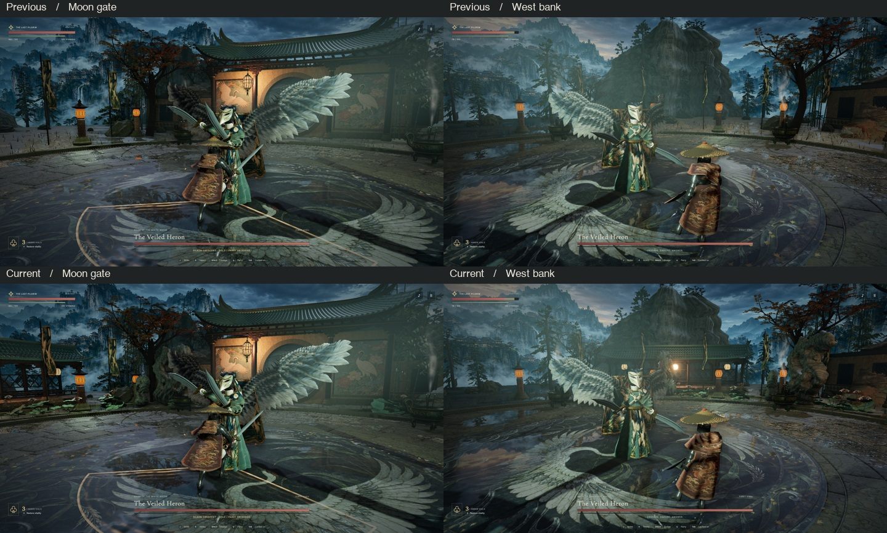

# Lotus pools and west water gallery

The controls, camera and combat clock are the same in both rows. The upper row uses revision `f685dcc` and the lower row uses `babbacc`. Chrome rendered the scenes at 1920 × 1080 on an Apple M1 Max. On Penitent, the Heron's crescent reduced player health from 100 to 79 on frame 48 in both builds. A lateral step then brought the west bank into view.

[Full entrance frame](entry.jpg) · [Crescent wind-up](windup.jpg) · [West gallery during combat](gallery.jpg) · [Lock-on camera near the outer curb](retreat.jpg) · [Strike timing](stroke.json)

Two curved pools sit beyond the outer course of paving. The lanterns, limestone and planting share the same reflected view as the wet court. Ripples distort that view across the water. Raised leaves, stems and three layers of petals break its surface. The main rock stands lower on the west bank to keep the Heron's wing and sword readable as she raises them. The five open bays along the water have benches, recessed lattice, projecting brackets and layered roof tiles.

[Full 29-second duel with stereo game audio](duel.mp4) · [Recorded result](duel.json)

The continuous recording follows regular combat input on Pilgrim, including lateral movement. It covers the awakened phase, five parries and the victory screen. At the fight camera's normal distance the small lotus blossoms have little contrast with the bank. The far ridge behind the gallery still has a broad, uniform silhouette.

[Three encounter clears](clears.json) · [Defeat and retry checks](retries.json) · [Build verification](https://github.com/lzongren/vesper-hollow-tide/actions/runs/43598486482)
