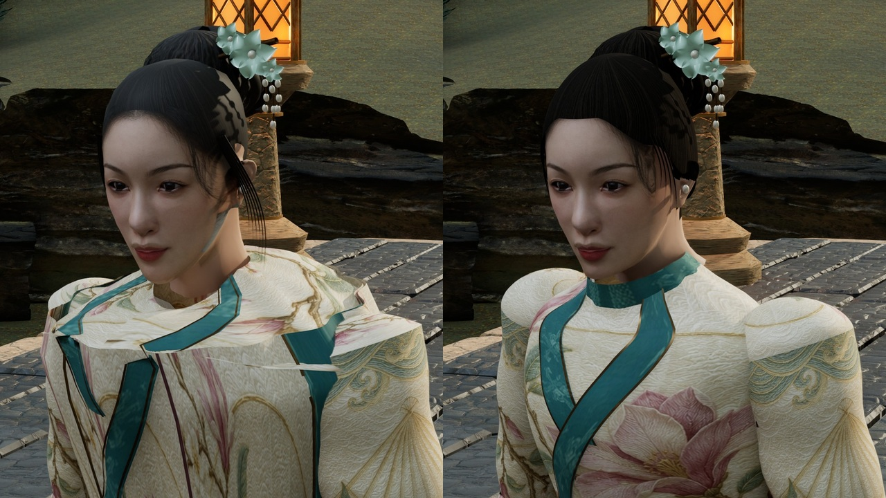

# Magnolia riding coat

The playable swordswoman's ivory bodice now follows a continuous surface from waist to neckline. The celadon lapels cross over the magnolia embroidery, and the raised collar follows the base of the neck when the head turns. A combed hair shell and a softer specular response reduce the broad patches of glare at the temple.

Both portraits use the same location, light and camera in the standalone Unreal Editor game. The [capture script](../../../native/Scripts/probe_magnolia.py) places the cameras on the possessed pawn. Full 2560 × 1440 frames show the [old fitting](../western-pass/after-front.jpg), [new fitting](front.jpg), [three-quarter view](profile.jpg), [rear view](rear.jpg) and [walking pose](walk.jpg).

The RTX 5080 route probe drove the possessed pawn from spawn through the three courts at 2560 × 1440 with a 60 FPS cap. The [combat trace](three-courts.json) records victories at 21.92, 61.17 and 98.70 seconds. It also records time between Slate post-tick callbacks.

The [Unreal CSV Profiler samples](frame-times.csv) contain the engine's frame, game-thread, render-thread, RHI-thread and GPU timings in milliseconds. The 5,747-frame capture starts after possession and ends on the third victory.

| Engine counter (ms) | Median | P95 | P99 | Maximum |
| --- | ---: | ---: | ---: | ---: |
| FrameTime | 16.67 | 18.82 | 21.34 | 143.31 |
| GameThreadTime | 2.39 | 4.66 | 8.24 | 72.87 |
| RenderThreadTime | 5.03 | 6.64 | 11.17 | 140.80 |
| RHIThreadTime | 2.25 | 2.62 | 3.24 | 23.45 |
| GPUTime | 4.71 | 5.85 | 6.50 | 9.70 |

Sixteen frames took more than 33.33 ms. All measurements were captured in the editor-hosted standalone game.
