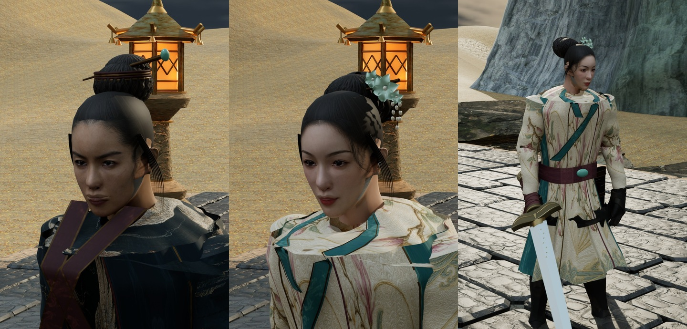

# 玉兰女侠

The playable mountain-route swordswoman wears a moon-white embroidered coat with a celadon crossing collar. A low, off-centre chignon carries a three-flower comb with pearl drops. The portrait is mapped to the sculpted jaw, eyelids and separate eye surfaces. Facial expression and hair ornaments currently follow a fixed pose.

The previous indigo outfit and the current magnolia outfit were photographed in the same standalone Unreal Editor game on the RTX 5080. The camera offsets, focal settings, lighting and location are matched. The individual screenshots below are full frames at 2560 × 1440.

[Previous face](../crane-wayfarer/after-front.jpg) · [Current face](after-front.jpg) · [Three-quarter view](after-profile.jpg) · [Back embroidery](after-rear.jpg) · [Walking](after-walk.jpg) · [Art sources](../../../native/Art/Wayfarer/)

A separate game-window capture follows the new player through the third encounter. The Saint of Cinders reached zero HP at 22.03 seconds. The 1280 × 720 capture is silent. [Watch the 43-second duel](duel.mp4) · [Combat trace](duel.json)
