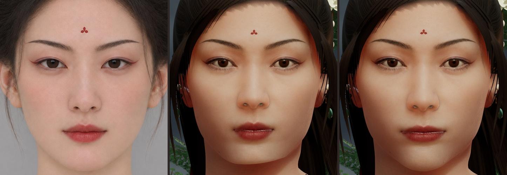
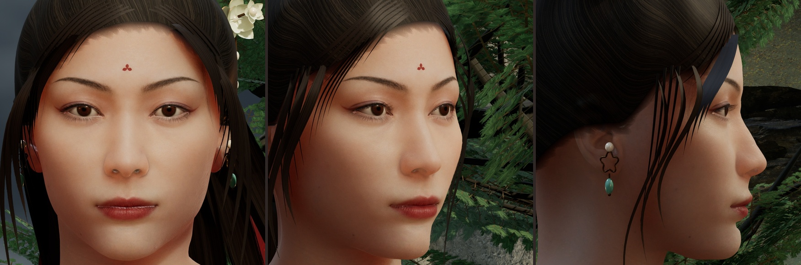

# 海棠脸型实机对照

从左到右是睁眼原画、修改前的可玩角色、修改后的可玩角色。三张均按瞳距等比例裁切，瞳心中点对齐。两张实机图使用同一地点、镜头焦距、机位和中性表情。

[实时转面录像](turntable.mp4) · [正面](open.jpg) · [38°](turn.jpg) · [88°](profile.jpg) · [闭眼](closed.jpg) · [张口](jaw.jpg)

## 修改与复核

UX／角色视觉评审首先指出原版下巴短、底边平。第一次只雕顶点，两侧的收拢有了改善，活动姿态里的颏尖却偏向画面左侧。静止网格的深度图仍然对称。第二次修改把前伸的下巴完整绑定到头骨，在下颌与咽喉之间渐变到颈骨，恢复了唇珠下方的圆弧。第三次按对齐后的原画下移鼻底和唇缝、展开嘴角，并给牙弓后方补了口腔内壁。第四次缩小内壁范围，修复它在第三次近景中穿出下巴的问题。

正面测量以同一张图的瞳距为单位。鼻底、嘴角和上下唇缝中心取自面部关键点。下颌弧线读数来自皮肤与颈部交界处的亮度下降，在中线和左右对称位置分别取宽约 0.09 个瞳距的像素带，用各列边缘坐标的中位斜率拟合局部轮廓，降低皮肤暗纹对单列读数的干扰。[各轮像素位置与测量](measurements.json)

Windows 本地运行 `native\Scripts\play_pilgrimage.ps1 -PortraitReview` 可复查五组视角与表情。去掉参数可进入正常战斗。

| 正面读数（瞳距为 1） | 原画 | 初版 | 最终实机 |
| --- | ---: | ---: | ---: |
| 唇缝到颏底 | 0.626 | 0.548 | 0.632 |
| 眼线到鼻底 | 0.804 | 0.757 | 0.798 |
| 嘴角间距 | 0.715 | 0.637 | 0.705 |
| 距中线 0.40 个瞳距处的颏底高度差 | 0.138 | 0.060 | 0.158 |
| 距中线 0.55 个瞳距处的颏底高度差 | 0.247 | 0.143 | 0.267 |

终审逐张检查正面、闭眼、38°、88° 和张口，确认颏尖在中线、两侧下颌连续，第四轮的口腔内壁保持在皮肤内。鬓角的发片边缘、亮唇缝和张口时一侧牙齿的反光仍较明显。

最终角色在 RTX 5080、2560 × 1440 的同一轮测试中依次打通三座庭院。记录中的三个胜场和玩家网格名对应同一次游戏运行。[战斗记录](three-courts.json) · [引擎构建记录](build.json)
