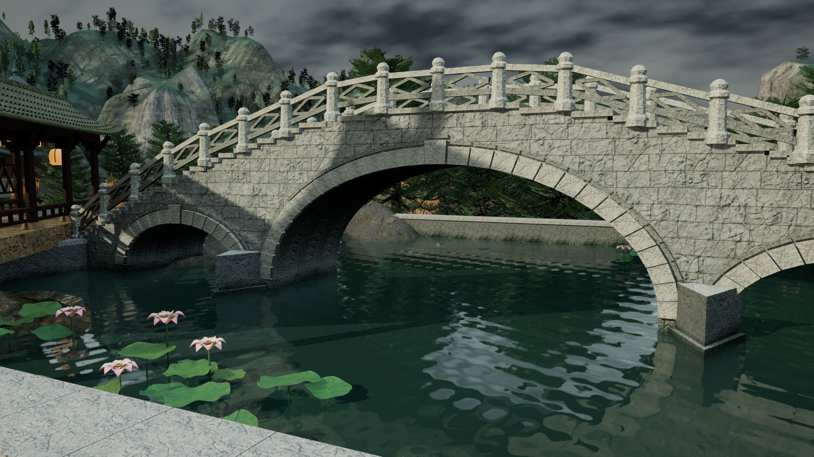

# 月门石桥与荷塘

桥长 28 米。中央桥洞横跨约 10 米，两侧的小拱各有单独的拱券石。上桥时能踏到逐级升高的石阶，桥顶比进桥处高 3.90 米。石墙上刻有错缝，水线附近的石面比栏板暗。水面使用 Unreal 的单层水材质，两岸的荷叶随各自的朝向展开纹理。桥下有局部衰减的水声。

| Unreal 游戏窗口的固定机位 | 改造前 | 改造后 |
| --- | --- | --- |
| 海棠与披纱鹭交手的位置 | [山崖](before-encounter.jpg) | [庭院与桥](after-encounter.jpg) |
| 庭院东缘 | [近岸](before-shore.jpg) | [中央桥洞](after-shore.jpg) |
| 水榭廊下 | [栏外山石](before-bridge.jpg) | [栏外池水](after-bridge.jpg) |
| 北侧平台 | [原地形](before-terrace.jpg) | [荷塘全景](after-terrace.jpg) |

[荷叶与花瓣近景](after-lotus.jpg) · [桥面跟随镜头](walk-crown.jpg)

一座山峰原先占据池塘的位置。改造把这一峰连同树丛、栈道和灯移到北岸，地形里的其余七峰保留原坐标。上表用相同镜位、焦距和庭院光照复拍，早期截图中的海棠采用上一版发髻。交手机位用脚本摆位，受击动作可能随帧时序变化。桥面行走和 Boss 试走使用正常跟随镜头。[拍摄脚本](../../../native/Scripts/probe_moon_water.py) · [桥与池岸几何](../../../native/Scripts/moon_bridge.py) · [荷叶原始纹理](../../../native/Art/MoonGarden/lotus-leaf.jpg)

从庭院西侧沿池岸走到北桥头，再沿石阶登顶、下桥，全程约 48.1 米。录像保留了走向桥顶的 7.5 秒和该游戏窗口的声音。下桥的位置与地面碰撞记录在完整路线里。桥面测试分两次从相反方向完成。

[过桥录像](crossing.mp4) · [从庭院出发的完整轨迹](from-court.json) · [反向过桥轨迹](crossing.json) · [下桥实机画面](walk-descent.jpg)

## 三庭帧耗时

最终骑装在同一庭院版本中用普通移动与攻击输入连续击败三位 Boss。RTX 5080、2560 × 1440、60 FPS 上限，单独运行且关闭录屏与截图。Unreal CSV Profiler 采到 5,879 帧，P95 为 18.94 ms，P99 为 21.39 ms，有 14 帧超过 33.33 ms。

[逐帧记录](frame-times.csv) · [三庭路线与胜利时刻](three-courts.json) · [新版海棠实机与交手录像](../lingbo-haitang/)
