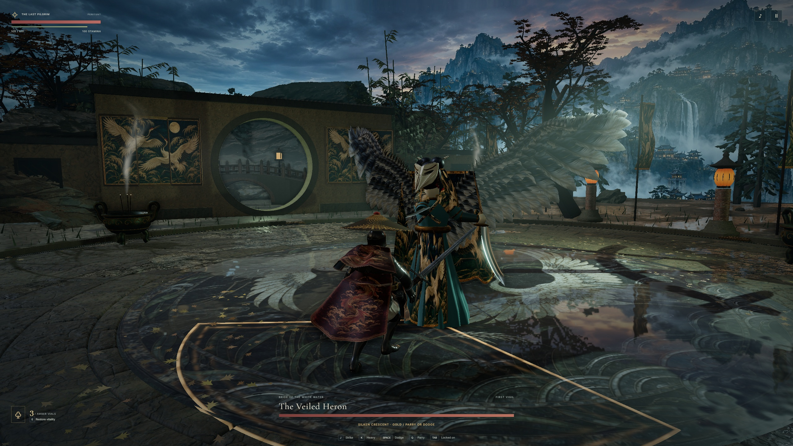

# The Veiled Heron at the moon gate

[Older and current fight at the same camera position](comparison.jpg) · [Opening view](moon-gate.jpg) · [Recovery pose](recovery.jpg) · [Full fight with stereo game audio](heron.mp4) · [Result screen](victory.jpg)

The new silhouette has a narrow porcelain face and a high waist. Open eye sockets, raised brows, small garnet pendants, pins and silk lappets are modeled pieces. Two hooked sabres follow the hands. A crossed collar, belted skirt and embroidered apron replace the wraith's exposed torso. The fight retains its existing skeleton, timings, damage and tells. The fitted outfit and hands still look stiff in close combat. The two skirts and the side veils need more independent motion.

The inner quills follow the upper wing. A second pivot lets the outer primaries sweep backward, then open at the top of a windup. Each wing carries 77 feathers in three tiers. The feathers share one painted quill texture, so repetition remains visible at close range. The model and silk construction are in [heron.ts](../../../src/heron.ts). The [headpiece GLB](../../../native/Art/HeronBridalMask.glb) has five mesh and material groups. Native editor import remains pending.

The stone crossing is built behind the moon gate. The arched opening, stepped deck, railings and lamp shift relative to the gate as the player circles. Wet stone retains its roughness between puddles. The distant cloud band continues over the camera where the previous sky cylinder ended. The mountain range is still a backdrop.

## Captures

The three full-size JPEGs came from a 2560 × 1440 Edge viewport on a Windows RTX 5080. The matched crops use the same encounter, key presses, 60 Hz simulation steps and crop. The film is a separate real-time Pilgrim fight from entry through awakening and the final knockdown, with 821 timestamped frames over 43.51 seconds at 1600 × 900. Its audio comes from the game mix. The result screen was captured separately after the recording ended. The capture rate of 18.9 images per second includes screencast overhead.

## Play and timing

The tester selected each boss from the menu, used keyboard input and observed the result through the HUD. Three Pilgrim clears reached the awakened phase, and three separate Penitent defeats returned to 100/100 health on Retry. M1 Max Chrome opened all three arenas at 1440 × 900, struck once, paused and returned to the menu in each. [Windows victories](victories.json) · [Windows defeats](defeats.json) · [Apple Silicon readback](mac.json)

The previous build exposed the HUD before submitting its first full render. The current build draws the opening scene and waits for a GPU fence before resetting the clock and enabling play. The table follows one three-boss sequence per build. The Bellwarden is always first in a fresh browser context. Subsequent fights share cached assets. The numbers measure browser callback intervals and include scheduling delays. They do not isolate GPU time or establish a sustained frame rate. [Previous sequence](previous-entries.json) · [Current sequence](victories.json)

| Encounter | Click to HUD, previous → current (s) | Longest intro interval, previous → current (s) | Current combat p95 | Longest current combat interval |
| --- | ---: | ---: | ---: | ---: |
| The Bellwarden | 0.49 → 5.09 | 4.62 → 0.67 | 16.8 ms | 2.91 s |
| The Veiled Heron | 3.75 → 3.49 | 0.35 → 0.05 | 16.8 ms | 1.74 s |
| Saint of Cinders | 4.84 → 4.84 | 0.36 → 0.43 | 16.8 ms | 1.67 s |

The cold Bellwarden load moved about 4.6 seconds of work ahead of the HUD. Click to combat stayed near 8.1 seconds in both runs. Live combat still exhibited 1.67–2.91 second stalls across the three courts.

The production archive from [GitHub Actions for 0ffd497](https://github.com/lzongren/vesper-hollow-tide/actions/runs/43586234800) matched all 61 files in both the local build and the Windows build used for the captures, by relative path and SHA-256.
