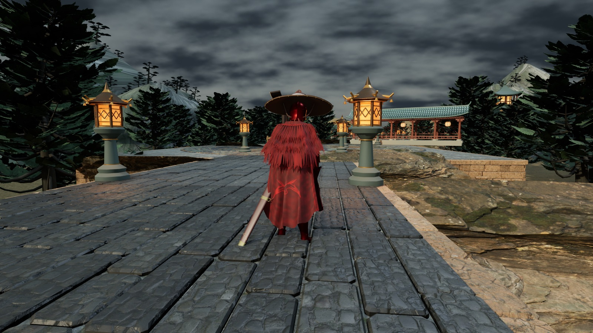
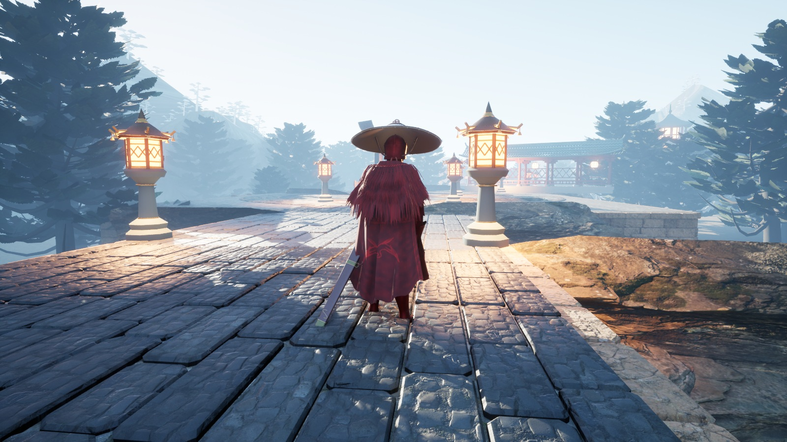
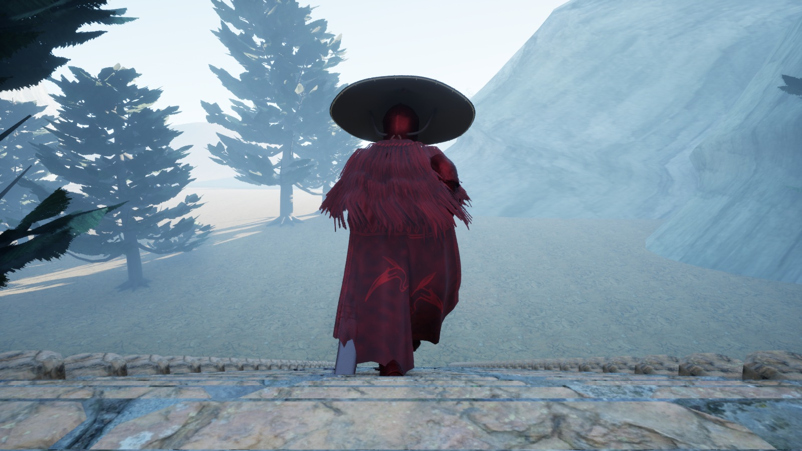
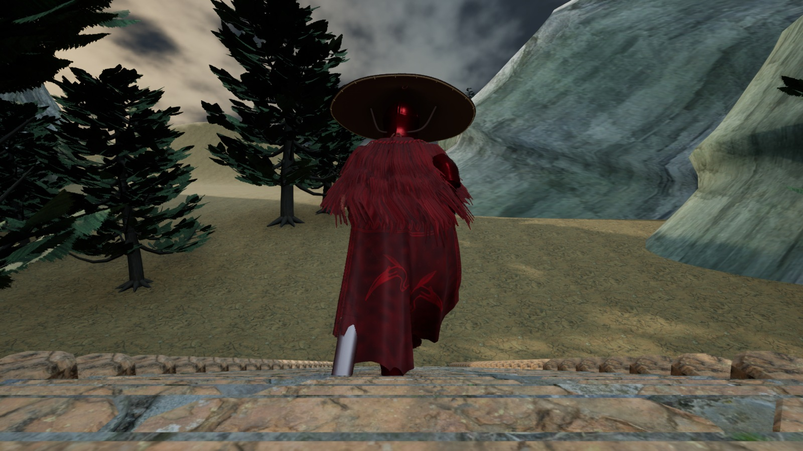
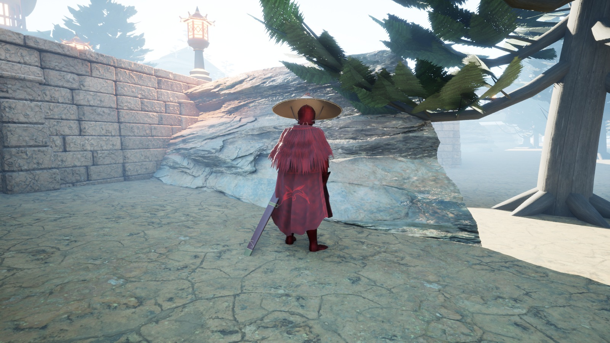
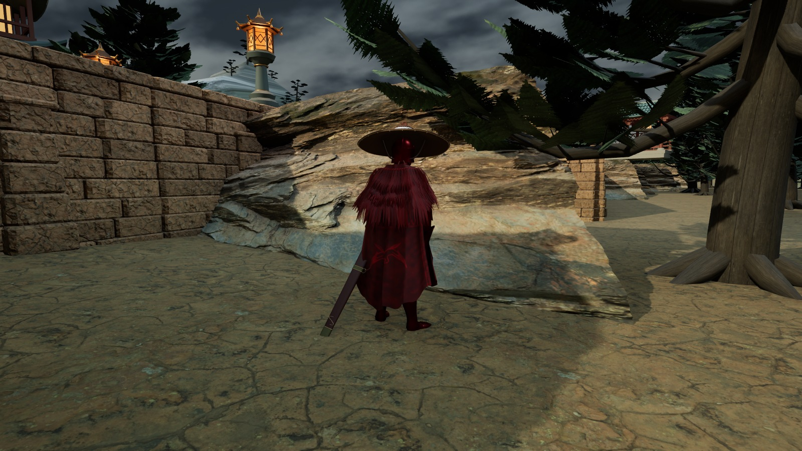

# Cloudbreak over the mountain pilgrimage

| Player camera | Previous map lighting | Evening cloud deck |
| --- | --- | --- |
| Lantern road |  |  |
| Descending the first stair |  |  |
| Valley bank |  |  |

[Looking back from the foot of the stairs](toe.jpg) · [The first courtyard after climbing back](return.jpg)

Captured in standalone Unreal Engine 5.8.4 at 1600 × 900 on a Windows RTX 5080. The previous and current captures use the same player, camera headings, route input and level geometry. The sky is an original 1536 × 768 HDR environment sampled by the visible dome and the movable skylight. A warm directional light crosses the road, with broad cool fill on the shadow side. The thinner height fog begins 17 m from the camera. Exposure adapts within 0.2–1.6 EV100.

The possessed traveller completed the first court stair in both directions with zero falling-mode samples. The final bank view then ran without screenshots for eight seconds under a 60 fps limit. Across 475 game-tick intervals, the median was 16.68 ms, the 95th percentile was 18.30 ms and the longest was 27.20 ms. The sample covers a warmed, stationary viewpoint and excludes boss combat.

[Lighting settings](lighting.json) · [Player, movement and timing samples](route.json)
