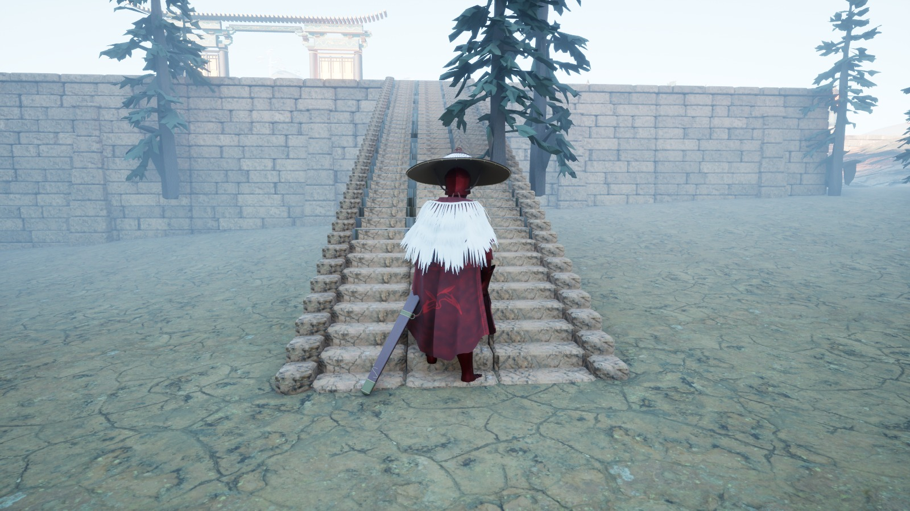

# The mountain causeway and its valley stair

[Road surface](road.jpg) · [Descending the steps](stairs.jpg) · [Back in the court after climbing](return.jpg) · [The retaining wall at the rock outcrop](bank.jpg)

All five views come from the possessed traveller’s camera in the same 1600 × 900 Unreal Engine 5.8.4 standalone session on an RTX 5080. The probe starts by placing the player on the first court. It then holds movement input down the stair, turns the camera, and climbs back up using the same pawn. The bank and road frames use separate starting positions.

The five road decks and three courts share a masonry perimeter. Its 96 sections cover 565.21 metres. Three meshes vary the stone bond and buttress position, and each stone has its own bevels, grain orientation and colour. Wall geometry extends below the valley surface. The three stair openings remain clear. The stairs have 104 dressed treads in total, including eight load-bearing steps at the foot of the first flight, fitted to the actual valley mesh. The other two flights already reach the terrain.

In the first court the player descended 13.93 m horizontally, then climbed 16.96 m horizontally and 5.84 m vertically to the courtyard. Falling-mode samples: 0 on descent, 0 on ascent. Both traversals ended grounded. This round trip covers the first flight.

[Level build measurements](masonry.json) · [Per-tick movement and camera positions](route.json)
