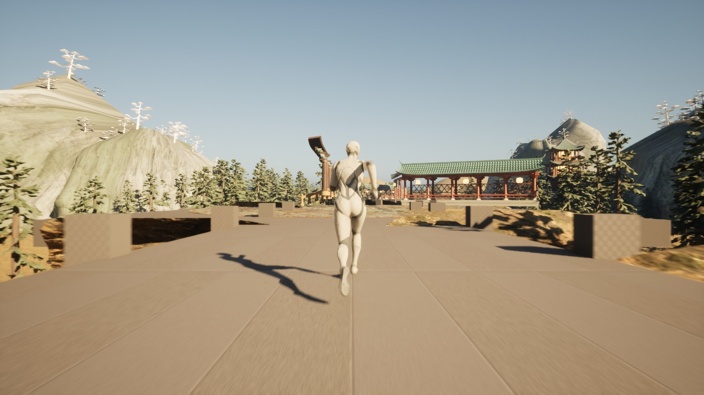

# Mountain Pilgrimage

[Unreal map measurements](map.json) · [Launch from a Windows checkout](../../../native/README.md)

## Native standalone run

[Native start, run and stop](native-motion.mp4) · [Character movement samples](native-motion.json) · [Capture timing](native-capture.json)

Unreal 5.8.4 ran the map at 1600 × 900 using DX12. The probe supplied forward movement to the possessed third-person character and released it. The movement-only sample covered 31.70 metres, reached 600 cm/s and finished at rest. Its 382 Slate tick intervals had a median of 17.35 ms and a 95th percentile of 37.09 ms. The initial run's screenshot requests failed after its launch frame, while movement sampling completed.

The second run produced 40 full engine screenshots over 8 seconds. The video retains the recorded timing, including the overhead of PNG readback. Its character covered 31.38 metres and again finished at rest. This clip checks poses and scale. The timing results above describe the first run. The opening road, rectangular markers, broad mountain shapes and Epic mannequin remain at prototype fidelity.

## Browser combat

[Movement and lock-on capture](browser-motion.mp4) · [Three full encounter results](browser-results.json)

Walking now ramps up to 5.2 metres per second, and releasing the control applies a faster braking curve. Gait phase advances with actual distance. A dodge travels 4.48 metres with a continuous velocity curve while retaining the original invulnerability window. The close-range lock-on camera shifts sideways to separate fighters on wide screens.

The RTX 5080 test played each browser fight to victory on Pilgrim difficulty. The 95th-percentile animation callback interval during active combat was 16.8 ms in all three. The slowest combat interval was 59.2 ms. Initial loads took 6.3–19.2 seconds. The MP4 uses deterministic browser stepping for inspection of movement and the camera. Live timing comes from the separate full-encounter runs.

The first standalone launch exposed a missing Nanite material permutation on the imported glTF surfaces. The preparation pass resaved all 36 route meshes for conventional rendering. The project also disables offline path tracing and enables the skin cache required by its real-time ray tracing configuration.
